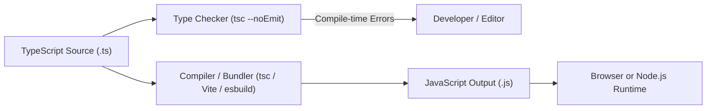

# Chapter 1: Introduction

[Back to README](./README.md) | [Next: Node.js Environments →](./02-node-environments.md)

---

## Background

In school, "working code" usually means code that passes the autograder once before you close your laptop and never look at it again. In the real world, code has to survive teammates, feature requests, and Future You (who will have zero memory of what `const temp2 = data.x` meant six months ago).

This guide is **not** a language tutorial — if you need to learn syntax, head to the [TypeScript Handbook](https://www.typescriptlang.org/docs/), the [MDN JavaScript Guide](https://developer.mozilla.org/en-US/docs/Web/JavaScript/Guide), or [javascript.info](https://javascript.info). Instead, this guide teaches you the **professional environment and tooling** around TypeScript.

---

## What Is TypeScript, and Why Should You Care?

TypeScript (created by Microsoft in 2012) is a **superset of JavaScript** that adds static types. Every valid `.js` file is already a valid `.ts` file — TypeScript just lets you add type annotations so your editor can yell at you *before* your users do.

### Why Bother with Types?

In plain JavaScript, this is completely legal:

```javascript
function add(a, b) {
  return a + b;
}

add("1", 2); // Returns "12". JavaScript smiles and says "Good job!"
```

In TypeScript, you tell the compiler what types you expect:

```typescript
function add(a: number, b: number): number {
  return a + b;
}

add("1", 2); // Compile Error: Argument of type 'string' is not assignable to parameter of type 'number'
```

That red squiggly line in your editor saves you from a 2 AM production bug. Specifically, TypeScript gives you:

- **Compile-time bug catching** — fix `undefined is not a function` before running the app
- **Supercharged autocomplete** — your IDE knows every property on every object
- **Self-documenting code** — function signatures tell teammates what goes in and what comes out
- **Fearless refactoring** — rename a field and the compiler shows every file you need to update

### How TypeScript Runs

Browsers don't understand TypeScript natively — they run JavaScript. So your workflow looks like this:



Modern build tools like Vite (Chapter 8) compile TypeScript automatically, and Node.js 22.6+ / 24+ can even run `.ts` files directly by stripping type annotations on the fly.

### The TypeScript Config: `tsconfig.json`

Every TypeScript project has a `tsconfig.json` at its root telling the compiler how strict to be:

```json
{
  "compilerOptions": {
    "target": "ES2022",
    "module": "ESNext",
    "moduleResolution": "Bundler",
    "strict": true,
    "outDir": "./dist"
  },
  "include": ["src/**/*"],
  "exclude": ["node_modules", "dist"]
}
```

The VIP setting here is `"strict": true`. Leaving `"strict": false` in TypeScript is like wearing a bike helmet unbuckled on your handlebars — always turn `"strict": true` on.

---

## Software Engineering Best Practices

A great language still needs guardrails. Throughout this guide, we'll wire up an automated pipeline where every tool has a clear job:


- **Version Control ([Chapter 4](./04-version-control.md))**: Track history and collaborate with Git and GitHub (no more `project_final_v2_REAL.zip`).
- **Linting ([Chapter 5](./05-linting.md))**: Catch sketchy code patterns automatically with [ESLint](https://eslint.org), [Oxlint](https://oxc.rs), or [Biome](https://biomejs.dev).
- **Formatting ([Chapter 6](./06-code-formatting.md))**: Auto-format code on save with [Biome](https://biomejs.dev) or [Prettier](https://prettier.io) so nobody argues about semicolons.
- **Unit Testing ([Chapter 7](./07-testing.md))**: Verify your logic in milliseconds with [Vitest](https://vitest.dev).
- **Build & Backend ([Chapters 8–11](./08-vite.md))**: Bundle frontends with [Vite](https://vite.dev), build APIs with [Fastify](https://fastify.dev), go full-stack with [TanStack Start](https://tanstack.com/start), and query databases safely with [Drizzle](https://orm.drizzle.team) or [Prisma](https://www.prisma.io).
- **CI/CD ([Chapter 13](./13-ci-cd.md))**: Let GitHub Actions run your tests on every push so broken code never lands on `main`.

> **A note on tool choices:** The JS/TS ecosystem spawns a new framework roughly every 45 minutes. We cover battle-tested, modern defaults here, but once you understand the concepts, switching to Bun, Deno, Hono, or Jest is easy.

---

## VSCode Setup

We assume you're using **[Visual Studio Code](https://code.visualstudio.com)** ([GitHub](https://github.com/microsoft/vscode)), though Cursor, Zed, WebStorm, or Neovim with LSP work great too. VSCode ships with TypeScript support built in — zero extensions required for autocomplete and type checking.

Grab these extensions (`Ctrl+Shift+X` / `Cmd+Shift+X`) as you go:

- **Biome** (`biomejs.biome`) or **ESLint** (`dbaeumer.vscode-eslint`) + **Prettier** (`esbenp.prettier-vscode`)
- **Error Lens** (`usernamehw.errorlens`) — prints compiler errors right next to your line of code so you don't have to hover like a detective
- **GitLens** (`eamodio.gitlens`) — shows who wrote which line (spoiler: six months from now, it was you)

---

## What's Next?

In [Chapter 2](./02-node-environments.md), we'll install Node.js and set up a version manager so your projects never fight over runtime versions.

[Back to README](./README.md) | [Next: Node.js Environments →](./02-node-environments.md)
