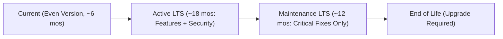
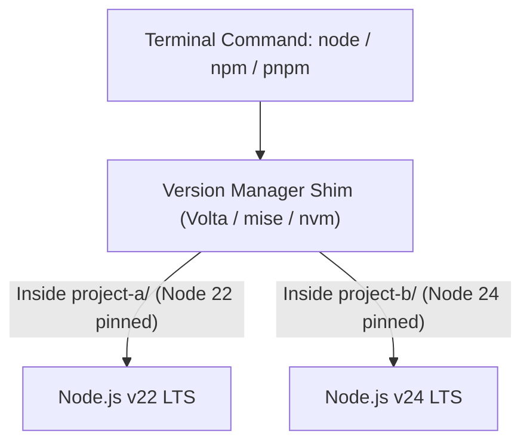

# Chapter 2: Node.js Environments

[← Previous: Introduction](./01-introduction.md) | [Back to README](./README.md) | [Next: Package Management →](./03-package-management.md)

---

## What Is Node.js?

[Node.js](https://nodejs.org) is the JavaScript runtime that lets you run JS and TypeScript tooling outside of a browser. Even if you're building a frontend React app, your compiler (`tsc`), bundler (Vite), linter, and test runner all run on Node.js.

> **Bonus in Node 22.6+ and Node 24+:** Node can now run `.ts` files directly by stripping type annotations on the fly (`node src/index.ts`). You still need `tsc --noEmit` to actually check your types, but for quick scripts, it's magic.

---

## LTS Releases: Which Version Should You Use?

Node.js releases a new major version twice a year:

- **Even-numbered versions (22, 24...)** become **Long Term Support (LTS)** releases (~30 months of support).
- **Odd-numbered versions (23, 25...)** are short-lived experimental releases. Ignore them unless you enjoy debugging runtime edge cases for fun.

**Rule of thumb:** Always pick the current **Active LTS** version (**Node 24** in 2026; **Node 22** is in Maintenance LTS). Node 18 and 20 have reached End of Life — do not use them for new projects. Check the [official Node.js release schedule](https://nodejs.org/en/about/previous-releases) anytime.

---

## Node Version Managers

If you install Node directly from a `.pkg` or `.msi` installer on your OS, you get *one* global version. The moment a class project requires Node 22 and your internship repo requires Node 24, you're stuck.

A **Node version manager** solves this by intercepting `node` commands and routing each project folder to its pinned Node version automatically:

Here are the three tools worth knowing:

- **[nvm](https://github.com/nvm-sh/nvm)** (and [nvm-windows](https://github.com/coreybutler/nvm-windows)): The classic shell-based Node version manager that switches Node versions per directory using a `.nvmrc` file.
- **[Volta](https://volta.sh)** ([GitHub](https://github.com/volta-cli/volta)): A blazing-fast, Rust-based tool manager that pins Node and package manager versions directly inside `package.json` and switches versions automatically with zero shell commands.
- **[mise](https://mise.jdx.dev)** ([GitHub](https://github.com/jdx/mise)): A polyglot, Rust-based version manager that manages Node.js alongside Python, Go, Rust, and Ruby using a single `.mise.toml` or `.tool-versions` file.

### Recommendations

- **Choose Volta** if you mainly write JavaScript/TypeScript and want a "set it and forget it" experience. Running `volta install node@24` and `volta pin node@24` locks the version in `package.json` for your whole team automatically.
- **Choose mise** if you bounce between TypeScript, Python, Go, or Rust across classes and projects and want one unified tool for every runtime.
- **Choose nvm** if you're working on an older project or following legacy docs that already standardize on `.nvmrc`.

---

## What's Next?

Now that Node is installed, let's tame `node_modules` and `package.json` in [Chapter 3: Package Management](./03-package-management.md).

[← Previous: Introduction](./01-introduction.md) | [Back to README](./README.md) | [Next: Package Management →](./03-package-management.md)
