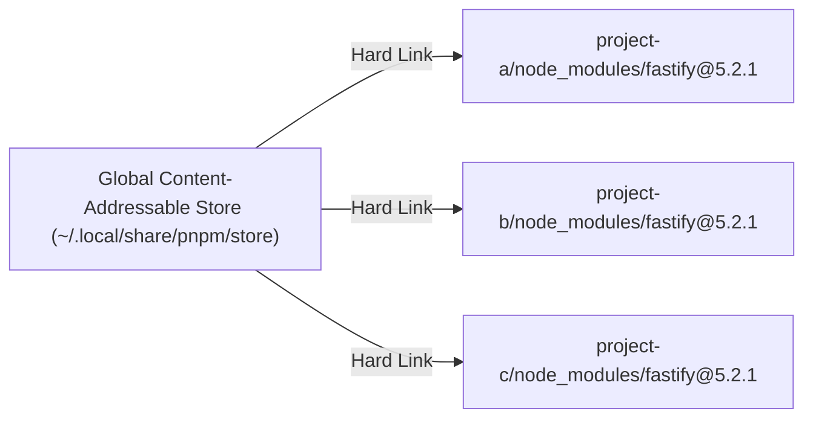
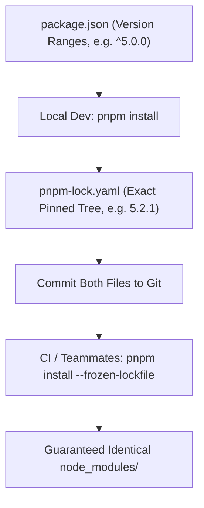

# Chapter 3: Package Management & package.json

[← Previous: Node.js Environments](./02-node-environments.md) | [Back to README](./README.md) | [Next: Version Control →](./04-version-control.md)

---

Every Node.js and TypeScript project revolves around one file: `package.json`. Think of it as your project's ID card, shopping list, and remote control all rolled into one.

---

## Anatomy of `package.json`

Create one with `pnpm init` (or `npm init`). Here is what a real-world TypeScript `package.json` looks like:

```json
{
  "name": "my-app",
  "version": "1.0.0",
  "description": "A sample TypeScript application",
  "license": "MIT",
  "type": "module",
  "engines": {
    "node": ">=22.0.0"
  },
  "packageManager": "pnpm@10.12.0",
  "scripts": {
    "dev": "vite",
    "build": "tsc --noEmit && vite build",
    "test": "vitest",
    "test:coverage": "vitest run --coverage",
    "lint": "eslint .",
    "format": "prettier --write .",
    "typecheck": "tsc --noEmit"
  },
  "dependencies": {
    "fastify": "^5.0.0"
  },
  "devDependencies": {
    "typescript": "^5.8.0",
    "vite": "^6.0.0",
    "vitest": "^3.0.0",
    "eslint": "^9.0.0",
    "prettier": "^3.0.0"
  }
}
```

### The Key Fields

- **`"type": "module"`**: Tells Node.js to use modern ES Modules (`import`/`export`) instead of 2012-era CommonJS (`require()`). Always set this for new projects.
- **`"scripts"`**: Terminal shortcuts you run with `pnpm <name>` (e.g., `pnpm dev`, `pnpm build`, `pnpm test`). Whenever you join a new repo, check `"scripts"` first — it tells you how the project works.
- **`"dependencies"` vs `"devDependencies"`**:
  - `dependencies` (`pnpm add fastify`) are needed at runtime in production.
  - `devDependencies` (`pnpm add -D typescript vitest`) are only used while developing, testing, or building.
  - The `^` in `"^5.0.0"` means "install the latest 5.x bugfix/minor version, but don't jump to 6.0.0 and break my app."
- **`"packageManager"` & Corepack**: Node ships with **Corepack**, which reads `"packageManager"` and automatically uses that exact version of pnpm. Enable it once with `corepack enable`.

---

## npm vs pnpm (and why we use pnpm)

**npm** comes bundled with Node.js. It works, but if you have 15 projects using React and TypeScript, npm downloads and duplicates 15 copies of those packages across your hard drive.

**[pnpm](https://pnpm.io)** is a drop-in replacement that stores each package version **once** in a global content-addressable store and hard-links it into your projects. It's up to 2–3x faster, saves gigabytes of disk space, and stops your code from accidentally importing undeclared packages.



### Essential pnpm Commands

```bash
# Enable pnpm via Node's built-in Corepack
corepack enable

pnpm install              # Install all dependencies in package.json
pnpm add fastify          # Add a production dependency
pnpm add -D typescript    # Add a dev dependency
pnpm remove fastify       # Remove a package
pnpm build                # Run the "build" script from package.json
pnpm dlx create-vite app  # Run a one-off CLI tool without installing it (like npx)
```

*(Note: You may also see [Yarn](https://yarnpkg.com) in older or enterprise repos. The same concepts apply.)*

---

## Lock Files and `node_modules`

When you run `pnpm install`, two things happen:

1. Packages are linked into **`node_modules/`** — the heaviest object in the known universe. **Never commit `node_modules/` to Git.** Always put it in `.gitignore`.
2. Exact version numbers are written to **`pnpm-lock.yaml`** (or `package-lock.json` in npm). **Always commit your lock file to Git.**



In CI pipelines, always run `pnpm install --frozen-lockfile` (or `npm ci`) so CI installs the exact versions from your lock file and fails if someone forgot to update it.

---

## What's Next?

Speaking of committing files — let's set up Git and `.gitignore` properly in [Chapter 4: Version Control](./04-version-control.md).

[← Previous: Node.js Environments](./02-node-environments.md) | [Back to README](./README.md) | [Next: Version Control →](./04-version-control.md)
