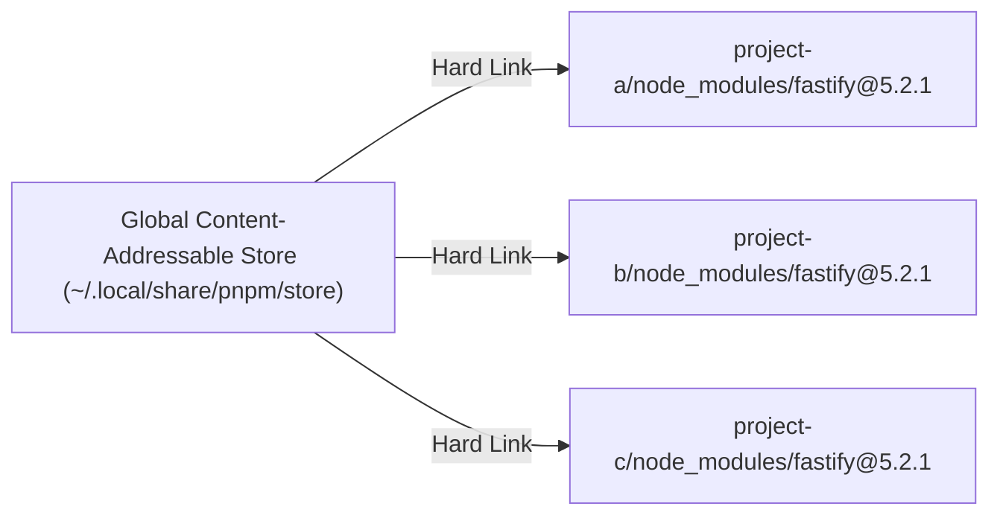
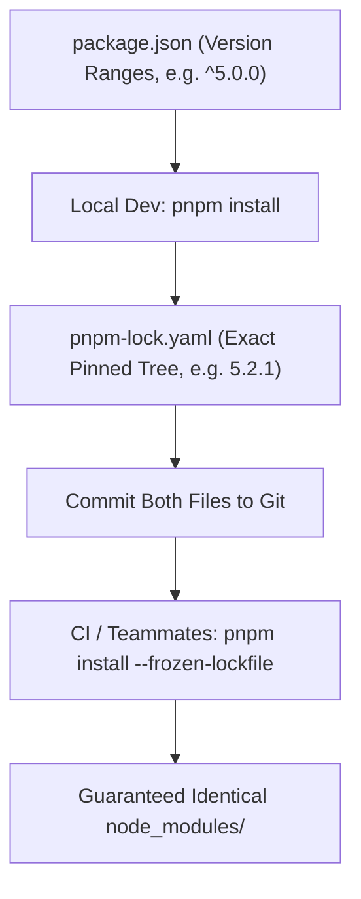

# Chapter 3: Package Management & package.json

[← Previous: Node.js Environments](./02-node-environments.md) | [Back to README](./README.md) | [Next: Version Control →](./04-version-control.md)

---

Every Node.js and TypeScript project revolves around one central file: `package.json`. It's the manifest for your project — it describes what your project is, what it depends on, and how to run it. In this chapter, you'll learn what package.json contains, how to manage packages with npm and pnpm, and why lock files are critical for reliable builds.

---

## What is package.json?

Think of `package.json` as the "birth certificate" of your project. It records:

- **Project identity** — name, version, author, license
- **Dependencies** — which external packages your project needs
- **Scripts** — shortcuts for common commands like building, testing, and linting

Every Node.js project has one. You create it by running `npm init` or `pnpm init` in your project directory. From that point on, every time you install a package, it gets recorded here automatically.

---

## Anatomy of package.json

Let's walk through a complete, realistic `package.json` for a TypeScript application and explain every section.

```json
{
  "name": "my-app",
  "version": "1.0.0",
  "description": "A sample TypeScript application",
  "author": "Your Name <you@example.com>",
  "license": "MIT",
  "type": "module",
  "engines": {
    "node": ">=22.0.0"
  },
  "packageManager": "pnpm@10.12.0",
  "scripts": {
    "dev": "vite",
    "build": "tsc --noEmit && vite build",
    "preview": "vite preview",
    "test": "vitest",
    "test:coverage": "vitest run --coverage",
    "lint": "eslint .",
    "format": "prettier --write .",
    "typecheck": "tsc --noEmit"
  },
  "dependencies": {
    "fastify": "^5.0.0"
  },
  "devDependencies": {
    "typescript": "^5.8.0",
    "vite": "^6.0.0",
    "vitest": "^3.0.0",
    "eslint": "^9.0.0",
    "prettier": "^3.0.0"
  }
}
```

### name, version, description, author, license

These fields describe your project's identity.

- **name** — the package name, lowercase, no spaces (use hyphens instead). If you publish to npm, this must be unique.
- **version** — follows [Semantic Versioning](https://semver.org): `MAJOR.MINOR.PATCH`. Start at `1.0.0` for a public release, or `0.1.0` while in early development.
- **description** — a short sentence describing what the project does.
- **author** — your name and email. The format `"Name <email>"` is conventional.
- **license** — the software license. `"MIT"` is the most common open-source choice for Node.js projects.

### type: "module"

This field controls how Node.js interprets your `.js` files — either as **ES Modules** or **CommonJS**.

**CommonJS** (the old way, before 2015):
```javascript
// Importing
const express = require('express');

// Exporting
module.exports = { myFunction };
```

**ES Modules** (the modern standard):
```javascript
// Importing
import express from 'express';

// Exporting
export { myFunction };
```

Setting `"type": "module"` tells Node.js to treat all `.js` files as ES Modules, so you can use `import` and `export` syntax. This is the right choice for new TypeScript projects because:

- TypeScript uses ES Module syntax natively
- Modern bundlers like Vite expect it
- ES Modules are the current standard across browsers and Node.js

If you omit `"type"` or set it to `"commonjs"`, Node.js uses the old `require()` style. You'll still encounter CommonJS in older codebases and some libraries, but for new projects, `"module"` is the way to go.

### scripts

Scripts are command shortcuts you can run from the terminal. Any command in the `scripts` section can be run with `npm run <name>` or `pnpm <name>`.

```json
"scripts": {
  "dev": "vite",
  "build": "tsc --noEmit && vite build",
  "preview": "vite preview",
  "test": "vitest",
  "test:coverage": "vitest run --coverage",
  "lint": "eslint .",
  "format": "prettier --write .",
  "typecheck": "tsc --noEmit"
}
```

Here's what each one does:

| Script | Command | Purpose |
|---|---|---|
| `dev` | `pnpm dev` | Start the development server with hot reload |
| `build` | `pnpm build` | Type-check, then compile and bundle for production |
| `preview` | `pnpm preview` | Preview the production build locally |
| `test` | `pnpm test` | Run the test suite |
| `test:coverage` | `pnpm test:coverage` | Run tests and generate a coverage report |
| `lint` | `pnpm lint` | Check code for errors and style issues |
| `format` | `pnpm format` | Auto-format all files with Prettier |
| `typecheck` | `pnpm typecheck` | Run the TypeScript compiler to check types only |

You can add any scripts you want. The names `dev`, `build`, and `test` are conventional — most tools and hosting platforms expect them.

### dependencies

These are packages your application needs to run in production. When someone deploys your app to a server and runs `pnpm install --prod`, only these packages get installed.

```json
"dependencies": {
  "fastify": "^5.0.0"
}
```

The `^` before the version number means "compatible with this version" — npm or pnpm may install `5.1.0` or `5.2.3`, but never `6.0.0`. This gives you bug fixes automatically while protecting against breaking changes.

Examples of runtime dependencies: `fastify`, `express`, `zod`, `drizzle-orm`, `@tanstack/react-query`.

### devDependencies

These packages are only needed during development — for building, testing, linting, and formatting. They are not installed in production, which keeps your deployment lean.

```json
"devDependencies": {
  "typescript": "^5.8.0",
  "vite": "^6.0.0",
  "vitest": "^3.0.0",
  "eslint": "^9.0.0",
  "prettier": "^3.0.0"
}
```

Examples of dev dependencies: `typescript`, `vite`, `vitest`, `eslint`, `prettier`, `@types/*` packages.

### engines

This field lets you declare the minimum version of Node.js your project requires. Tools like pnpm will warn users if their Node.js version doesn't match.

```json
"engines": {
  "node": ">=22.0.0"
}
```

This is especially useful when working in a team or publishing a library — it prevents confusion when someone runs your project on an old Node.js version and gets mysterious errors.

### packageManager and Corepack

Node.js ships **Corepack**, which can activate a specific package manager version for your project. Adding a `packageManager` field locks the team onto the same pnpm (or yarn) version:

```json
"packageManager": "pnpm@10.12.0"
```

Then enable Corepack once on each machine:

```bash
corepack enable
```

When someone runs `pnpm` in the project, Corepack ensures they get the version declared in `package.json`. Commit that field so CI and teammates stay aligned. You can set it with:

```bash
corepack use pnpm@latest
```

---

## npm — Node Package Manager

npm comes bundled with Node.js, so you already have it. It's the original package manager for the Node.js ecosystem and the most widely used.

Here are the commands you'll use most often:

```bash
# Install all dependencies listed in package.json
npm install

# Add a runtime dependency (saved to "dependencies")
npm install express

# Add a dev dependency (saved to "devDependencies")
npm install -D typescript

# Remove a package
npm uninstall express

# Run a script from package.json
npm run build

# Clean install — uses lock file exactly, no updates (great for CI)
npm ci

# Run a package without installing it globally
npx create-vite my-app
```

When you run `npm install`, it creates a `package-lock.json` file that records the exact versions of every installed package. More on that in the lock files section below.

---

## pnpm — the Faster Alternative

[pnpm](https://pnpm.io) is a modern package manager that is a drop-in replacement for npm, but with significant advantages:

- **Faster installs** — packages are stored once in a global content-addressable store, then hard-linked into your project. If 10 projects use the same version of React, it's only downloaded once.
- **Less disk space** — that global store means your total disk usage for packages is dramatically lower.
- **Stricter dependency isolation** — pnpm prevents packages from accessing dependencies they haven't declared, which catches hidden dependency bugs early.



### Installing pnpm

```bash
# Option 1: Install via npm
npm install -g pnpm

# Option 2: Enable via Corepack (bundled with Node.js, recommended)
corepack enable
corepack prepare pnpm@latest --activate
```

If your project already has a `"packageManager": "pnpm@..."` field, `corepack enable` is enough — Corepack will use that version when you run `pnpm` inside the project.

### pnpm commands

The commands mirror npm closely:

```bash
# Install all dependencies
pnpm install

# Add a runtime dependency
pnpm add express

# Add a dev dependency
pnpm add -D typescript

# Remove a package
pnpm remove express

# Run a script (two equivalent ways)
pnpm run build
pnpm build          # shorthand — no "run" needed for non-built-in scripts

# Run a package without installing it (like npx)
pnpm dlx create-vite my-app
```

pnpm creates a `pnpm-lock.yaml` lock file instead of `package-lock.json`.

**Recommendation:** Use pnpm for new projects. It's faster, uses less disk space, and its stricter isolation helps you catch dependency problems earlier. The rest of this tutorial uses pnpm in examples.

---

## Yarn — Brief Note

[Yarn](https://yarnpkg.com) (especially **Yarn Berry** / Yarn 2+) is another popular package manager. You may encounter it in existing codebases. Key points if you join a Yarn project:

- Classic Yarn (v1) used `yarn.lock` and a familiar `node_modules` layout.
- Yarn Berry often uses **Plug'n'Play (PnP)** by default (no traditional `node_modules`), which can require IDE plugins and extra config. Many teams switch Berry to the `node_modules` linker for simpler tooling.
- Commands are similar: `yarn add`, `yarn add -D`, `yarn install`, `yarn <script>`.

This guide standardizes on **pnpm** for examples. Concepts (lock files, dependencies vs devDependencies, scripts) transfer directly to npm and Yarn.

---

## Lock Files — Why They Matter

When you run `pnpm install`, pnpm does two things:

1. Reads `package.json` to find which packages you need
2. Writes (or updates) a **lock file** — `pnpm-lock.yaml` — with the exact version of every package and sub-package that was installed

The lock file answers a critical question: if `package.json` says `"fastify": "^5.0.0"`, which exact version is actually installed? The lock file records the answer — say, `5.2.1` — so every developer on your team, and every CI server, installs the exact same thing.

Without a lock file, two developers running `pnpm install` a week apart might end up with different versions of a dependency, leading to "works on my machine" bugs.



**Rules for lock files:**

- Always commit your lock file to version control (`git add pnpm-lock.yaml`)
- Never manually edit it
- In CI, use `pnpm install --frozen-lockfile` to enforce that the installed packages match the lock file exactly

```bash
# Development: update lock file if needed
pnpm install

# CI: fail if lock file doesn't match package.json
pnpm install --frozen-lockfile

# npm equivalent for CI
npm ci
```

---

## node_modules — the Dependency Folder

When you run `pnpm install`, all downloaded packages land in a folder called `node_modules/`. This folder can contain tens of thousands of files and grow to hundreds of megabytes — even for a simple project.

**Important rules:**

- **Never commit `node_modules/` to git.** It's enormous, redundant (the lock file is enough to recreate it), and causes serious performance problems in repositories.
- **Always add it to `.gitignore`** (covered in the next chapter):
  ```
  node_modules/
  ```
- **Anyone can recreate it** by cloning your repo and running `pnpm install`.

If you accidentally commit `node_modules/`, you can remove it from git tracking with:

```bash
git rm -r --cached node_modules
git commit -m "Remove node_modules from tracking"
```

---

## npx and pnpm dlx — Running Tools Without Installing

Sometimes you want to run a command-line tool just once — for example, to scaffold a new project — without cluttering your global npm installation.

**npx** (comes with npm) and **pnpm dlx** let you download and run a package temporarily:

```bash
# Create a new Vite project (npm)
npx create-vite my-app

# Same thing with pnpm
pnpm dlx create-vite my-app

# Run Biome linter without installing it
pnpm dlx @biomejs/biome --help

# Check your Node.js version compatibility
npx check-node-version --node ">= 22"
```

These commands download the package to a temporary location, run it, and clean up. They're especially useful for scaffolding tools you only need once, and for trying out tools before deciding to add them as a project dependency.

---

## Optional: monorepos with pnpm workspaces

If one repo holds multiple packages (for example `apps/web`, `apps/api`, `packages/shared`), pnpm **workspaces** let you install and link them from a single lock file. Create `pnpm-workspace.yaml`:

```yaml
packages:
  - 'apps/*'
  - 'packages/*'
```

Run `pnpm install` from the repo root. Shared libraries can be referenced with `workspace:*` protocol. Full monorepo design is outside this guide's scope, but knowing workspaces exist will help when a project outgrows a single package.

---

## What's Next?

You now understand the heart of every Node.js project: `package.json`, how to manage dependencies with npm and pnpm, and why lock files and `.gitignore` matter. The next step is learning how to track your code changes over time with version control.

[← Previous: Node.js Environments](./02-node-environments.md) | [Back to README](./README.md) | [Next: Version Control →](./04-version-control.md)
