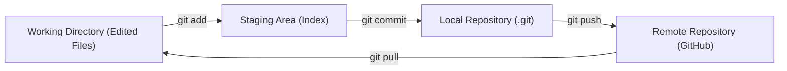
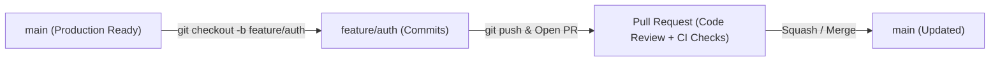

# Chapter 4: Version Control

[← Previous: Package Management & package.json](./03-package-management.md) | [Back to README](./README.md) | [Next: Linting →](./05-linting.md)

---

If you've ever named a folder `project_final_FINAL_v3_fixed` or had a group project partner overwrite your code on Google Drive, you already know why version control exists.

**[Git](https://github.com/git/git)** is the universal time machine for code. It tracks every change, lets you experiment safely on branches, and enables teamwork via [GitHub](https://github.com).

---

## Basic Git Workflow

Check that Git is installed with `git --version` (if not, grab it via `brew install git`, `sudo apt install git`, or [git-scm.com](https://git-scm.com/downloads)).



Here is the core loop you'll run dozens of times a week:

```bash
# 1. Set your name and email (once per machine)
git config --global user.name "Your Name"
git config --global user.email "you@example.com"

# 2. Initialize Git in your project folder
git init

# 3. Check which files changed
git status

# 4. Stage changes and save a snapshot (commit)
git add .
git commit -m "Add user authentication endpoint"

# 5. View compact commit history
git log --oneline
```

> **Pro tip on commit messages:** Write what changed and why (`"Fix crash when email is empty"`), not `"asdf"` or `"stuff"`. Future You debugging at 1 AM will be grateful.

---

## `.gitignore` for TypeScript Projects

Some files have no business being in Git: `node_modules/` (huge and reproducible), `dist/` (compiled output), and `.env` (contains your API keys and database passwords — pushing `.env` to a public repo is how crypto miners end up on your AWS bill within 4 minutes).

Create a `.gitignore` file in your project root:

```gitignore
# Dependencies & build output
node_modules/
dist/
build/
*.tsbuildinfo

# Test coverage
coverage/

# Environment variables — NEVER commit secrets!
.env
.env.local
.env.*.local

# Logs & OS clutter
*.log
.DS_Store
Thumbs.db

# Editor state (keep .vscode/extensions.json if sharing team recommendations)
.idea/
.vscode/
```

Commit a safe `.env.example` with blank placeholders (`DATABASE_URL=`) so teammates know which variables to set locally.

---

## Branching & GitHub Flow

On a real team, nobody pushes straight to `main` and prays. Instead, teams use **GitHub Flow**:

1. `main` is always deployable.
2. Create a feature branch (`feature/user-auth` or `fix/login-bug`).
3. Commit and push your branch to GitHub, then open a **Pull Request (PR)**.
4. Automated CI checks run, a teammate reviews your code, and you merge into `main`.



```bash
# Create and switch to a new branch
git checkout -b feature/add-user-auth

# Stage, commit, and push the branch to GitHub
git add .
git commit -m "Add user authentication endpoint"
git push -u origin feature/add-user-auth
```

---

## What's Next?

Your code is safely tracked in Git. Next, let's set up an automated code reviewer that catches bugs in milliseconds in [Chapter 5: Linting](./05-linting.md).

[← Previous: Package Management & package.json](./03-package-management.md) | [Back to README](./README.md) | [Next: Linting →](./05-linting.md)
