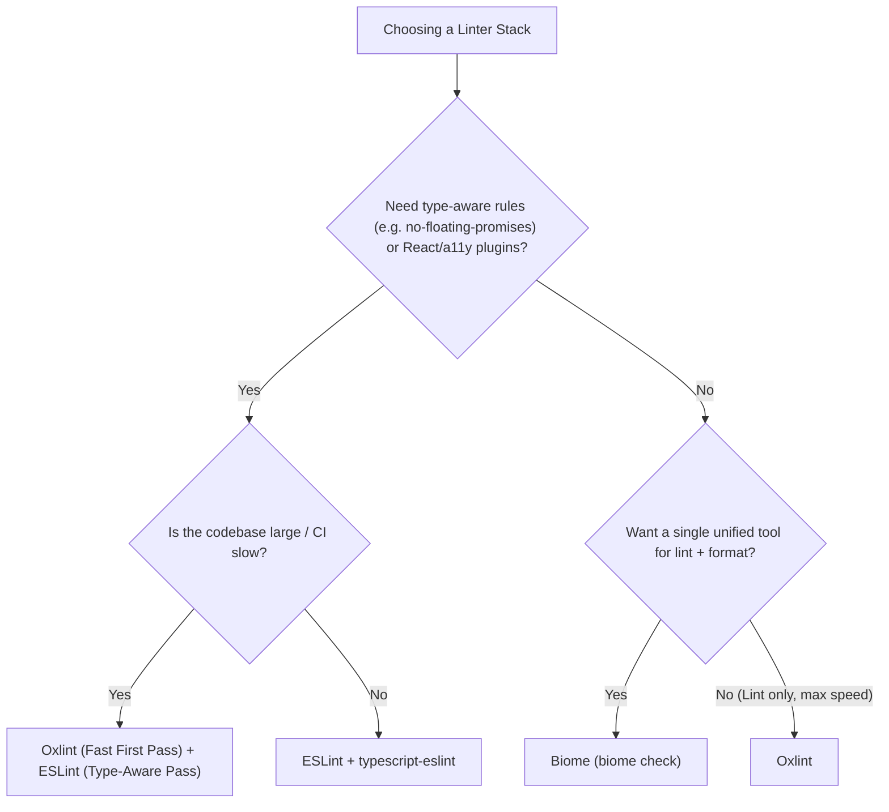

# Chapter 5: Linting

[← Previous: Version Control](./04-version-control.md) | [Back to README](./README.md) | [Next: Code Formatting →](./06-code-formatting.md)

---

Your TypeScript code compiles with zero errors — time to celebrate? Not quite. Look at this completely valid TypeScript function:

```typescript
import { readFile } from 'fs';  // Unused import collecting dust

function greet(name: any) {     // "any" turns off TypeScript's brain
  const greeting = "Hello";     // Declared, never used
  return `Hi, ${name}!`;
  console.log("Done");          // Unreachable code — after return!
}
```

A **linter** statically analyzes your code (reads it without running it) and flags all four of those crimes in milliseconds. Think of it as a tireless senior engineer reviewing your code as you type, minus the judgmental sighs.

---

## Option 1: ESLint — The Battle-Tested Standard

[ESLint](https://eslint.org) ([GitHub](https://github.com/eslint/eslint)) paired with [typescript-eslint](https://typescript-eslint.io) is the classic powerhouse. Its superpower is **type-aware linting**: it hooks into the TypeScript compiler to catch bugs like floating (un-awaited) Promises that simpler linters miss.

### Setup

```bash
pnpm add -D eslint @eslint/js typescript-eslint
```

Create `eslint.config.ts` (ESLint v9+ flat config):

```typescript
import eslint from "@eslint/js";
import tseslint from "typescript-eslint";

export default tseslint.config(
  eslint.configs.recommended,
  ...tseslint.configs.recommendedTypeChecked,
  {
    languageOptions: {
      parserOptions: {
        project: true,
        tsconfigRootDir: import.meta.dirname,
      },
    },
  },
  {
    rules: {
      "@typescript-eslint/no-explicit-any": "error",
      "@typescript-eslint/no-floating-promises": "error",
      "no-console": "warn",
    },
  },
  {
    ignores: ["dist/**", "node_modules/**"],
  },
);
```

Run it with `pnpm eslint .` (or `pnpm eslint . --fix` to auto-repair issues).

---

## Option 2: Oxlint — The Rust Speed Demon

[Oxlint](https://oxc.rs/docs/guide/usage/linter) ([GitHub](https://github.com/oxc-project/oxc)), part of the Rust-based [Oxc project](https://oxc.rs), is **50–100x faster than ESLint**. A lint run that takes ESLint 20 seconds finishes in Oxlint before your finger leaves the `Enter` key.

```bash
pnpm add -D oxlint
pnpm oxlint .
```

Oxlint works with zero configuration out of the box and catches hundreds of common bugs (`no-unused-vars`, `no-debugger`, `eqeqeq`), though it doesn't replace ESLint's full plugin ecosystem yet.

---

## Option 3: Biome — The All-in-One Linter & Formatter

[Biome](https://biomejs.dev) ([GitHub](https://github.com/biomejs/biome)) is a Rust-based tool that replaces **both** ESLint and Prettier with a single dependency and a single `biome.json` file.

```bash
pnpm add -D @biomejs/biome
pnpm biome init
```

Example `biome.json`:

```json
{
  "$schema": "https://biomejs.dev/schemas/2.0.0/schema.json",
  "linter": {
    "enabled": true,
    "rules": {
      "recommended": true,
      "correctness": {
        "noUnusedVariables": "error",
        "noUnusedImports": "error"
      },
      "suspicious": {
        "noExplicitAny": "error"
      }
    }
  },
  "files": {
    "ignore": ["dist/**", "node_modules/**"]
  }
}
```

Run `pnpm biome check --write .` to lint, format, and sort imports in one shot.

---

## Recommendations



- **For new projects wanting simplicity and speed:** Use **Biome**. One package, one config file, handles both linting and formatting (used in Chapter 15).
- **For deep TypeScript safety or React plugins:** Use **ESLint + `typescript-eslint`**. Type-aware rules like `no-floating-promises` will save you from silent async bugs.
- **For large repos or serverless functions where speed is king:** Use **Oxlint** (either standalone as in Chapter 17, or as a fast pre-pass before ESLint).
- **Golden rule:** Pick **one** primary lint stack per project so tools don't fight over your code.

---

## What's Next?

Linters catch logic bugs; formatters make your code look clean. Let's end style debates forever in [Chapter 6: Code Formatting](./06-code-formatting.md).

[← Previous: Version Control](./04-version-control.md) | [Back to README](./README.md) | [Next: Code Formatting →](./06-code-formatting.md)
