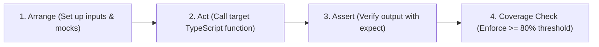

# Chapter 7: Unit Testing with Vitest

[← Previous: Code Formatting](./06-code-formatting.md) | [Back to README](./README.md) | [Next: Building with Vite →](./08-vite.md)

---

In university, testing often means running your program once, typing `"5"` into the terminal, seeing `"25"`, and calling it a day. In real software, changing one line in `billing.ts` can accidentally break `checkout.ts`.

**Unit tests** are automated checks that call your functions and verify the results in milliseconds. TypeScript checks your *types*; unit tests check your *logic*.



---

## Why Vitest?

You'll see **[Jest](https://jestjs.io)** in many older repos, but Jest was built before TypeScript and ES Modules were standard, so configuring it today feels like assembling IKEA furniture without the manual.

**[Vitest](https://vitest.dev)** ([GitHub](https://github.com/vitest-dev/vitest)) is the modern default: it uses the same Jest-compatible API (`describe`, `it`, `expect`), runs significantly faster, and supports TypeScript and ES Modules out of the box with zero Babel nonsense.

---

## Setting Up Vitest

```bash
pnpm add -D vitest @vitest/coverage-v8
```

Create `vitest.config.ts`:

```typescript
import { defineConfig } from 'vitest/config';

export default defineConfig({
  test: {
    globals: true,
    environment: 'node', // use 'jsdom' for browser/React component tests
    coverage: {
      provider: 'v8',
      reporter: ['text', 'html'],
      include: ['src/**/*.ts'],
      exclude: ['src/**/*.test.ts'],
      thresholds: {
        lines: 80,
        functions: 80,
        branches: 80,
      },
    },
  },
});
```

Add scripts to `package.json`:

```json
{
  "scripts": {
    "test": "vitest",
    "test:run": "vitest run",
    "test:coverage": "vitest run --coverage"
  }
}
```

---

## Writing Your First Tests

Suppose we have `src/calculator.ts`:

```typescript
export function add(a: number, b: number): number {
  return a + b;
}

export function divide(a: number, b: number): number {
  if (b === 0) {
    throw new Error('Cannot divide by zero');
  }
  return a / b;
}
```

Create `src/calculator.test.ts` right next to it:

```typescript
import { describe, it, expect } from 'vitest';
import { add, divide } from './calculator';

describe('calculator', () => {
  it('adds positive and negative numbers', () => {
    expect(add(2, 3)).toBe(5);
    expect(add(-1, 1)).toBe(0);
  });

  it('divides two numbers', () => {
    expect(divide(10, 2)).toBe(5);
  });

  it('throws when dividing by zero', () => {
    expect(() => divide(10, 0)).toThrow('Cannot divide by zero');
  });
});
```

### Handy Assertions Cheat Sheet

```typescript
expect(val).toBe(42);                              // Primitives (===)
expect(obj).toEqual({ id: 1, name: 'Alice' });     // Deep object/array equality
expect(arr).toContain('item');                     // Array/string membership
expect(() => badFn()).toThrow('Error message');    // Synchronous errors
await expect(asyncFn()).resolves.toEqual({ ok: true }); // Async success
await expect(badAsyncFn()).rejects.toThrow();      // Async rejection
```

---

## Running Tests & Code Coverage

- **`pnpm test`**: Starts interactive watch mode — edit a file and affected tests re-run instantly.
- **`pnpm test:run`**: Runs all tests once and exits (used in CI).
- **`pnpm test:coverage`**: Runs tests and prints a coverage table showing which lines, branches, and functions were tested. Open `coverage/index.html` in your browser to see uncovered lines highlighted in red. Because we set `thresholds: { lines: 80 }`, CI will fail if test coverage drops below 80%.

---

## What's Next?

Your code is tested. Next, let's bundle it for the browser with [Chapter 8: Building with Vite](./08-vite.md).

[← Previous: Code Formatting](./06-code-formatting.md) | [Back to README](./README.md) | [Next: Building with Vite →](./08-vite.md)
