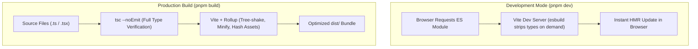

# Chapter 8: Building with Vite

[← Previous: Unit Testing with Vitest](./07-testing.md) | [Back to README](./README.md) | [Next: REST APIs with Fastify →](./09-fastify.md)

---

Browsers don't speak TypeScript, and they don't want to download 400 separate `.js` files over slow mobile Wi-Fi. A **build tool** compiles your TypeScript, bundles your modules, strips unused code (**tree-shaking**), and minifies assets for production.

Historically, developers used **Webpack** — a tool so complex that "Webpack config engineer" was practically a full-time job. Today, the standard for new projects is **[Vite](https://vite.dev)** ([GitHub](https://github.com/vitejs/vite), French for "fast").

---

## How Vite Works

Vite splits development and production into two specialized modes:



- **Development (`pnpm dev`)**: Serves native ES Modules directly to the browser and uses **esbuild** to strip TypeScript types on the fly. Server startup is instant, and **Hot Module Replacement (HMR)** updates your UI in milliseconds without losing component state.
- **Production (`pnpm build`)**: Uses **Rollup** to tree-shake, minify, and output cache-busted files (like `index-Bx3Qk2rA.js`) into `dist/`.

> **Crucial catch:** Vite's esbuild step only *strips* TypeScript types for speed — it does **not** type-check them! Always pair `vite build` with `tsc --noEmit`:
> ```json
> "scripts": {
>   "dev": "vite",
>   "build": "tsc --noEmit && vite build",
>   "preview": "vite preview",
>   "typecheck": "tsc --noEmit"
> }
> ```

---

## Scaffolding & Configuring a Vite Project

Spin up a new project in seconds:

```bash
pnpm create vite my-app
cd my-app
pnpm install
pnpm dev
```

Here is a clean `vite.config.ts` (shown with React support via `@vitejs/plugin-react`):

```typescript
import { defineConfig } from 'vite';
import react from '@vitejs/plugin-react';
import { fileURLToPath, URL } from 'node:url';

export default defineConfig({
  plugins: [react()],
  resolve: {
    alias: {
      // Let "@/components/Button" point to "src/components/Button" (ESM-safe)
      '@': fileURLToPath(new URL('./src', import.meta.url)),
    },
  },
  build: {
    outDir: 'dist',
    sourcemap: true,
  },
});
```

---

## Quick Reference

```bash
pnpm create vite          # Scaffold a new Vite project
pnpm dev                  # Start dev server with instant HMR (http://localhost:5173)
pnpm build                # Run tsc --noEmit && bundle into dist/
pnpm preview              # Test the production dist/ build locally
```

---

## What's Next?

Frontend bundling is handled! Now let's cross over to the backend and build a high-speed REST API in [Chapter 9: REST APIs with Fastify](./09-fastify.md).

[← Previous: Unit Testing with Vitest](./07-testing.md) | [Back to README](./README.md) | [Next: REST APIs with Fastify →](./09-fastify.md)
