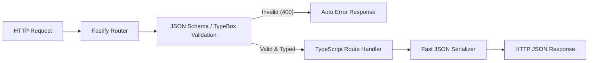

# Chapter 9: REST APIs with Fastify

[← Previous: Building with Vite](./08-vite.md) | [Back to README](./README.md) | [Next: Full-Stack with TanStack Start →](./10-tanstack-start.md)

---

Every frontend app, mobile client, or CLI eventually needs a backend server to talk to. A **REST API** listens for HTTP requests (`GET`, `POST`, `PUT`, `DELETE`) and replies with JSON.

Most college courses still teach **Express** — which was revolutionary in 2010, before TypeScript and `async/await` existed. Today, **[Fastify](https://fastify.dev)** ([GitHub](https://github.com/fastify/fastify)) is a much stronger default: it handles ~3–4x more requests per second than Express, ships with first-class TypeScript generics, includes built-in Pino structured logging, and validates incoming JSON automatically.



---

## Setting Up Fastify

```bash
mkdir my-api && cd my-api
pnpm init
pnpm add fastify @fastify/type-provider-typebox @sinclair/typebox
pnpm add -D typescript @types/node tsx
```

*(Note: `tsx watch` runs your TypeScript server with live reload during development; on Node 24+, you can also use `node --watch src/server.ts`.)*

Add scripts to `package.json`:

```json
{
  "type": "module",
  "scripts": {
    "dev": "tsx watch src/server.ts",
    "build": "tsc",
    "start": "node dist/server.js"
  }
}
```

---

## Type-Safe Routes with TypeBox Validation

TypeScript types disappear at runtime — so if a user sends `{ "age": "banana" }` in a `POST` request, TypeScript alone won't stop them.

Pairing Fastify with **[TypeBox](https://github.com/sinclairzx81/typebox)** solves both problems at once: you define a schema once, Fastify validates incoming HTTP requests at runtime (automatically returning `400 Bad Request` on invalid input), and TypeScript infers `request.body` and `request.params` automatically.

Create `src/server.ts`:

```typescript
import Fastify from 'fastify';
import { TypeBoxTypeProvider } from '@fastify/type-provider-typebox';
import { Type, type Static } from '@sinclair/typebox';

const fastify = Fastify({ logger: true }).withTypeProvider<TypeBoxTypeProvider>();

const UserSchema = Type.Object({
  id: Type.Number(),
  name: Type.String({ minLength: 1 }),
  email: Type.String({ format: 'email' }),
});

const CreateUserSchema = Type.Omit(UserSchema, ['id']);
type User = Static<typeof UserSchema>;

const users: User[] = [{ id: 1, name: 'Alice', email: 'alice@example.com' }];

fastify.get('/health', async () => ({ status: 'ok' }));

fastify.get('/users', async (): Promise<User[]> => users);

fastify.post(
  '/users',
  { schema: { body: CreateUserSchema } },
  async (request, reply) => {
    // request.body is validated at runtime AND typed as { name: string; email: string }
    const newUser: User = { id: users.length + 1, ...request.body };
    users.push(newUser);
    return reply.status(201).send(newUser);
  },
);

const start = async () => {
  try {
    await fastify.listen({ port: 3000, host: '0.0.0.0' });
  } catch (err) {
    fastify.log.error(err);
    process.exit(1);
  }
};

start();
```

Test it in a second terminal while `pnpm dev` is running:

```bash
curl http://localhost:3000/users
curl -X POST http://localhost:3000/users \
  -H "Content-Type: application/json" \
  -d '{"name":"Charlie","email":"charlie@example.com"}'
```

---

## Calling APIs from TypeScript: HTTP Clients

Your frontend, CLI, or another service also needs to *call* HTTP APIs. You rarely need a full library for that:

- **Built-in `fetch`** (Node 18+, stable in Node 21+): the WHATWG standard API you already know from the browser. Zero dependencies, works with `async/await`, but it **does not reject on 4xx/5xx** — check `response.ok` yourself.
- **[undici](https://undici.nodejs.org)** ([GitHub](https://github.com/nodejs/undici)): the high-performance HTTP client that powers Node's global `fetch`. Install it directly when you need connection pooling, custom agents/proxies, or lower overhead in a busy service.
- **[axios](https://axios-http.com)** ([GitHub](https://github.com/axios/axios)): the most popular third-party client, with interceptors, automatic JSON parsing, and a familiar browser/Node API. Convenient, but it is an extra dependency when `fetch` already ships with Node.

```typescript
// Built-in fetch: nothing to install
const res = await fetch('https://api.example.com/users', {
  signal: AbortSignal.timeout(5_000),
});
if (!res.ok) throw new Error(`HTTP ${res.status}: ${res.statusText}`);
const users = (await res.json()) as User[];

// undici: `pnpm add undici` for connection pooling and lower-overhead requests
import { request } from 'undici';
const { statusCode, body } = await request('https://api.example.com/users');
if (statusCode >= 400) throw new Error(`HTTP ${statusCode}`);
const users = (await body.json()) as User[];
```

**Rule of thumb:** start with `fetch`; reach for `undici` when you need pooling, performance tuning, or proxy control; choose `axios` when you want interceptors or are maintaining an existing axios codebase.

---

## Essential Plugins & Recommendations

Fastify keeps its core lean and adds features via official plugins:

- **`@fastify/cors`**: Allow your Vite frontend (`localhost:5173`) to call your API (`localhost:3000`)
- **`@fastify/swagger` + `@fastify/swagger-ui`**: Auto-generate interactive OpenAPI docs from your TypeBox schemas
- **`@fastify/jwt`** & **`@fastify/rate-limit`**: Authentication and abuse protection

### Recommendations

- **Choose Fastify** for standalone Node.js REST APIs and microservices where performance, built-in validation, and clean TypeScript ergonomics matter.
- **Choose [Hono](https://hono.dev)** if you are deploying to edge runtimes (Cloudflare Workers, Deno, Bun) and want an ultralight web-standard router.
- **Learn [Express](https://expressjs.com)** only when maintaining existing codebases — don't pick it for greenfield TypeScript projects.

---

## What's Next?

What if you don't want to maintain a separate frontend repo and backend repo at all? Enter [Chapter 10: Full-Stack with TanStack Start](./10-tanstack-start.md).

[← Previous: Building with Vite](./08-vite.md) | [Back to README](./README.md) | [Next: Full-Stack with TanStack Start →](./10-tanstack-start.md)
