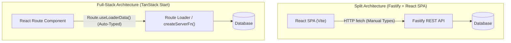

# Chapter 10: Full-Stack with TanStack Start

[← Previous: REST APIs with Fastify](./09-fastify.md) | [Back to README](./README.md) | [Next: Database Libraries →](./11-databases.md)

---

Building a separate Fastify API and React SPA is great when your API serves mobile apps, third-party developers, and a web frontend. But if you're building a web app where the frontend and backend live together, maintaining two repos means keeping types in sync twice.

**Full-stack frameworks** put your UI and server logic in one project so database types flow straight into your React components automatically.



---

## Why TanStack Start?

[TanStack Start](https://tanstack.com/start) ([GitHub](https://github.com/TanStack/router)) combines **Vite** with **TanStack Router** — the most type-safe router in the React ecosystem:

- **File-based, 100% inferred routing**: Create `app/routes/users/$userId.tsx` and `/users/:userId` exists automatically with `params.userId` typed as `string`. Mistype a `<Link to="/usres">` URL and `tsc` catches it immediately.
- **Server Functions (`createServerFn`)**: Write server-only functions (database queries, secret API calls) and call them from React loaders or components like normal async TypeScript functions — zero manual `fetch()` boilerplate.

---

## Scaffolding & Structure

Check [tanstack.com/start](https://tanstack.com/start) for the latest interactive initializer:

```bash
pnpm create tsrouter-app my-fullstack-app
cd my-fullstack-app
pnpm install
pnpm dev
```

Key files in `app/`:
- `app/routes/__root.tsx` — Root layout wrapping every page (`<Outlet />`)
- `app/routes/index.tsx` — Home page (`/`)
- `app/routes/users/$userId.tsx` — Dynamic route (`/users/:userId`)
- `app/server/` — Server-only functions and database queries

---

## Server Functions + Route Loaders in Action

1. Define a server function in `app/server/users.ts`:

```typescript
import { createServerFn } from '@tanstack/react-start';

export interface User {
  id: number;
  name: string;
  email: string;
}

const usersData: User[] = [
  { id: 1, name: 'Alice', email: 'alice@example.com' },
  { id: 2, name: 'Bob', email: 'bob@example.com' },
];

// Runs strictly on the server; never bundled into browser JS
export const getUsers = createServerFn().handler(async (): Promise<User[]> => {
  return usersData;
});
```

2. Call it from a route loader in `app/routes/users/index.tsx`:

```typescript
import { createFileRoute } from '@tanstack/react-router';
import { getUsers } from '../../server/users';

export const Route = createFileRoute('/users/')({
  loader: () => getUsers(),
  component: UsersPage,
});

function UsersPage() {
  // Automatically inferred as User[] — no manual type annotations!
  const users = Route.useLoaderData();

  return (
    <ul>
      {users.map((u) => (
        <li key={u.id}>{u.name} ({u.email})</li>
      ))}
    </ul>
  );
}
```

Rename `email` to `contactEmail` in `User`, and TypeScript immediately points to `u.email` in your React component.

---

## Recommendations: TanStack Start vs. Fastify + SPA

- **Choose TanStack Start** when building a web-first application where you want SSR, file-based routing, and automatic end-to-end type safety in a single deployment.
- **Choose Fastify + a separate Vite SPA** when your backend API also serves iOS/Android apps, public webhooks, or other backend services, or when frontend and backend teams deploy independently.

---

## What's Next?

Hardcoded arrays like `usersData` disappear every time the server restarts. Let's hook up a real database in [Chapter 11: Database Libraries](./11-databases.md).

[← Previous: REST APIs with Fastify](./09-fastify.md) | [Back to README](./README.md) | [Next: Database Libraries →](./11-databases.md)
