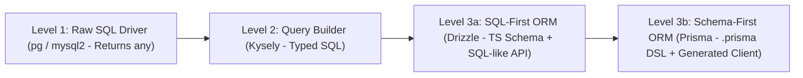
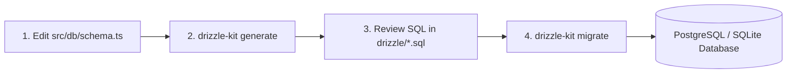

# Chapter 11: Database Libraries

[← Previous: Full-Stack with TanStack Start](./10-tanstack-start.md) | [Back to README](./README.md) | [Next: Logging →](./12-logging.md)

---

Storing users in a JavaScript array works great right up until your server restarts and everyone's account vanishes into thin air. Real apps need a database — and in TypeScript, you want your database queries to be just as type-safe as the rest of your code.

## The Database Abstraction Spectrum

When talking to a SQL database from Node.js, you can work at three levels of abstraction:



If you write raw SQL strings with `pg`, `result.rows[0]` is typed as `any` — one typo in `SELCT * FORM usres` and your app crashes at runtime. Let's look at the type-safe alternatives.

---

## 1. Drizzle ORM — SQL-First & Lightweight

[Drizzle ORM](https://orm.drizzle.team) ([GitHub](https://github.com/drizzle-team/drizzle-orm)) lets you define your database schema in plain TypeScript and write queries that look just like SQL.

```bash
pnpm add drizzle-orm pg
pnpm add -D drizzle-kit @types/pg
```

Define your schema in `src/db/schema.ts`:

```typescript
import { pgTable, serial, varchar, timestamp } from 'drizzle-orm/pg-core';

export const users = pgTable('users', {
  id: serial('id').primaryKey(),
  name: varchar('name', { length: 255 }).notNull(),
  email: varchar('email', { length: 255 }).notNull().unique(),
  createdAt: timestamp('created_at').defaultNow().notNull(),
});
```

Connect and run type-safe CRUD queries:

```typescript
import { drizzle } from 'drizzle-orm/node-postgres';
import { eq } from 'drizzle-orm';
import { Pool } from 'pg';
import { users } from './schema';

const db = drizzle(new Pool({ connectionString: process.env.DATABASE_URL }));

// Inferred return type: { id: number; name: string; email: string; createdAt: Date }[]
const allUsers = await db.select().from(users);

const [newUser] = await db
  .insert(users)
  .values({ name: 'Charlie', email: 'charlie@example.com' })
  .returning();

await db.update(users).set({ name: 'Charles' }).where(eq(users.id, newUser.id));
```

### Migrations with Drizzle Kit



Run `pnpm drizzle-kit generate` to create SQL migration files, `pnpm drizzle-kit migrate` to apply them, and `pnpm drizzle-kit studio` to browse your tables in a web UI. See [js-db-crud / FastifyV2](https://github.com/amitsk/js-db-crud/tree/main/FastifyV2) for a full Fastify + Drizzle example.

---

## 2. Prisma — Schema-First & Batteries Included

[Prisma](https://www.prisma.io) ([GitHub](https://github.com/prisma/prisma)) uses a declarative `.prisma` file to generate a tailored TypeScript client.

```bash
pnpm add prisma @prisma/client
pnpm prisma init
```

Define models in `prisma/schema.prisma`:

```prisma
model User {
  id        Int      @id @default(autoincrement())
  name      String
  email     String   @unique
  posts     Post[]
}

model Post {
  id        Int    @id @default(autoincrement())
  title     String
  author    User   @relation(fields: [authorId], references: [id])
  authorId  Int
}
```

Run `pnpm prisma migrate dev` to sync the database and generate the client, then query away:

```typescript
import { PrismaClient } from '@prisma/client';
const prisma = new PrismaClient();

// Creates a user AND their first post in one transaction; return type includes posts!
const userWithPost = await prisma.user.create({
  data: {
    name: 'Bob',
    email: 'bob@example.com',
    posts: { create: { title: 'Hello World' } },
  },
  include: { posts: true },
});
```

---

## 3. Kysely — The Type-Safe SQL Query Builder

[Kysely](https://kysely.dev) ([GitHub](https://github.com/kysely-org/kysely)) isn't an ORM — it's a pure SQL query builder with bulletproof TypeScript inference. No magic, just autocomplete for every table, join, and column:

```typescript
const user = await db
  .selectFrom('users')
  .select(['id', 'name'])
  .where('email', '=', 'alice@example.com')
  .executeTakeFirst(); // Inferred as { id: number; name: string } | undefined
```

---

## 4. DynamoDB — Serverless NoSQL on AWS

Building on AWS Lambda ([Chapter 17](./17-aws-lambda.md))? Traditional SQL databases struggle when thousands of serverless functions open connections at once. **[Amazon DynamoDB](https://aws.amazon.com/dynamodb/)** is a serverless key-value/document store that scales effortlessly over HTTP.

```bash
pnpm add @aws-sdk/client-dynamodb @aws-sdk/lib-dynamodb
```

```typescript
import { DynamoDBClient } from '@aws-sdk/client-dynamodb';
import { DynamoDBDocumentClient, PutCommand, GetCommand } from '@aws-sdk/lib-dynamodb';

export const ddb = DynamoDBDocumentClient.from(new DynamoDBClient({ region: 'us-east-1' }));

await ddb.send(new PutCommand({
  TableName: 'MyAppTable',
  Item: { PK: 'USER#alice', SK: 'PROFILE', name: 'Alice' },
}));
```

See [fastify-ddb](https://github.com/amitsk/fastify-ddb) for a complete Fastify + DynamoDB starter.

---

## Recommendations

- **Choose Drizzle ORM** if you know basic SQL and want a fast, tiny, TypeScript-native ORM with zero codegen steps and small bundle sizes.
- **Choose Prisma** if you want the fastest possible onboarding for a team and love readable nested relation queries (`include: { posts: true }`).
- **Choose Kysely** if you love writing complex SQL (CTEs, window functions, multi-table joins) and want strict TypeScript checking without ORM magic.
- **Choose DynamoDB** when building serverless AWS Lambda services with predictable key-value access patterns.
- **Student tip:** Don't want to install PostgreSQL locally yet? Both Drizzle and Prisma support **SQLite** (a single local `dev.db` file) — start there and switch to Postgres when you deploy!

---

## What's Next?

Now that your app has a database, how do you know what it's doing in production without littering `console.log("HERE")` everywhere? Let's set up structured logging in [Chapter 12: Logging](./12-logging.md).

[← Previous: Full-Stack with TanStack Start](./10-tanstack-start.md) | [Back to README](./README.md) | [Next: Logging →](./12-logging.md)
