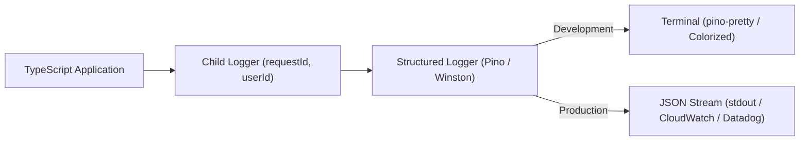

# Chapter 12: Logging

[← Previous: Database Libraries](./11-databases.md) | [Back to README](./README.md) | [Next: CI/CD →](./13-ci-cd.md)

---

We've all debugged code like this:

```typescript
console.log("here");
console.log("here 2");
console.log("WHY IS THIS NULL", user);
```

`console.log` is fine for a homework script, but in production it's a disaster: there are no timestamps, no severity levels, no way to filter out noise, and `console.log` is synchronous — under heavy traffic, it actually slows your server down.

**Structured loggers** output machine-searchable JSON in production (with timestamps, log levels, and request IDs) while printing colorized, human-friendly text on your laptop during development.



---

## Option 1: Pino — Fast & Built into Fastify

[Pino](https://github.com/pinojs/pino) is an ultra-fast asynchronous JSON logger and is **built directly into Fastify**. It ships its own TypeScript types out of the box.

```bash
pnpm add pino
pnpm add -D pino-pretty
```

```typescript
import pino from "pino";

const logger = pino(
  { level: process.env.LOG_LEVEL ?? "info" },
  process.env.NODE_ENV === "development"
    ? pino.transport({ target: "pino-pretty", options: { colorize: true } })
    : process.stdout
);

logger.info("Server starting up");
logger.error({ err, host: "localhost" }, "Database connection failed");

// Child loggers attach context (like requestId) to every log line automatically!
const reqLog = logger.child({ requestId: "req-99", userId: 42 });
reqLog.info("Checkout completed");
```

In Fastify, you don't even need to instantiate Pino manually — just enable `logger` on your Fastify instance and call `request.log.info(...)` inside any route.

---

## Option 2: Winston — Flexible Multi-Transport Logging

[Winston](https://github.com/winstonjs/winston) is the most widely deployed logger in older Express apps and services that need to route logs to multiple destinations at once (e.g., `info` to stdout, `error` to `errors.log`, and alerts to Datadog).

```bash
pnpm add winston
```

```typescript
import winston from "winston";

const logger = winston.createLogger({
  level: "info",
  format: winston.format.combine(winston.format.timestamp(), winston.format.json()),
  transports: [
    new winston.transports.Console(),
    new winston.transports.File({ filename: "errors.log", level: "error" }),
  ],
});

logger.info("Application started");
logger.error("Database connection failed", { port: 5432 });
```

---

## Recommendations

- **Use Pino** for Fastify APIs, high-throughput services, and AWS Lambda functions. It's asynchronous, minimal, and outputs clean JSON that CloudWatch and Datadog love.
- **Use Winston** if you're working on an Express codebase or need complex in-process routing to multiple files and custom transports.
- **Keep `console.log`** solely for tiny CLI scripts — and turn on your linter's `no-console` rule in backend services so stray debug prints don't sneak into production.

---

## What's Next?

You've got type checking, linting, formatting, tests, and logging. Now let's make GitHub run all of those checks automatically on every push in [Chapter 13: CI/CD](./13-ci-cd.md).

[← Previous: Database Libraries](./11-databases.md) | [Back to README](./README.md) | [Next: CI/CD →](./13-ci-cd.md)
