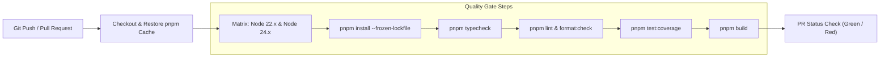

# Chapter 13: CI/CD

[← Previous: Logging](./12-logging.md) | [Back to README](./README.md) | [Next: LLMs and AI-Powered Development →](./14-llms.md)

---

"It works on my machine!" is the most famous excuse in computer science. Unfortunately, we don't ship your laptop to users.

- **Continuous Integration (CI)** automatically runs your type checker, linter, formatter check, and unit tests on a clean cloud server every time someone pushes code or opens a Pull Request.
- **Continuous Deployment (CD)** automatically deploys your app to production once CI gives the green light.

If a teammate (or an overconfident AI agent) pushes code with a broken type or failing test, GitHub blocks the PR before it can pollute `main`.



---

## A Complete GitHub Actions Workflow

[GitHub Actions](https://github.com/features/actions) is built into GitHub and is free for public repos (with 2,000 free minutes/month on private repos). Create `.github/workflows/ci.yml`:

```yaml
name: CI

on:
  push:
    branches: [main]
  pull_request:
    branches: [main]

jobs:
  quality:
    name: Quality Checks
    runs-on: ubuntu-latest

    strategy:
      matrix:
        node-version: [22.x, 24.x]

    steps:
      - name: Checkout code
        uses: actions/checkout@v4

      - name: Install pnpm
        uses: pnpm/action-setup@v4
        with:
          version: 10

      - name: Set up Node.js ${{ matrix.node-version }}
        uses: actions/setup-node@v4
        with:
          node-version: ${{ matrix.node-version }}
          cache: 'pnpm'

      - name: Install dependencies
        run: pnpm install --frozen-lockfile

      - name: Type check
        run: pnpm typecheck

      - name: Lint
        run: pnpm lint

      - name: Check formatting
        run: pnpm format:check

      - name: Run tests with coverage
        run: pnpm test:coverage

      - name: Build
        run: pnpm build
```

### Why This Setup Works So Well

- **`strategy.matrix`**: Runs your entire test suite in parallel on both **Node 22 LTS** and **Node 24 LTS**.
- **`cache: 'pnpm'`**: Caches your downloaded packages keyed by `pnpm-lock.yaml`, turning a 2-minute install into a 15-second install.
- **`--frozen-lockfile`**: Refuses to run if someone updated `package.json` without committing the updated `pnpm-lock.yaml`.

### Run CI Locally Before Pushing

Save yourself the embarrassment of a failed GitHub notification by running your CI checks locally before `git push`:

```bash
pnpm typecheck && pnpm lint && pnpm test:run && pnpm build
```

*(Want to test the actual `.yml` workflow locally in Docker? Check out [`act`](https://github.com/nektos/act).)*

---

## What's Next?

Your automated quality gates are locked in. Now let's put them to work as guardrails for AI coding agents in [Chapter 14: LLMs and AI-Powered Development](./14-llms.md).

[← Previous: Logging](./12-logging.md) | [Back to README](./README.md) | [Next: LLMs and AI-Powered Development →](./14-llms.md)
