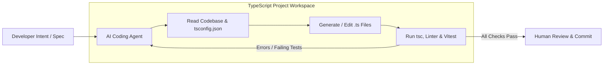
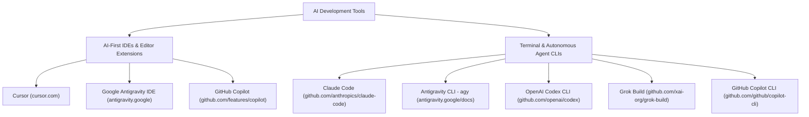
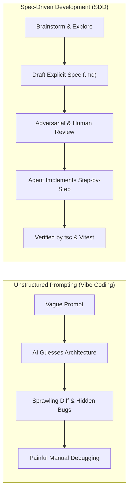
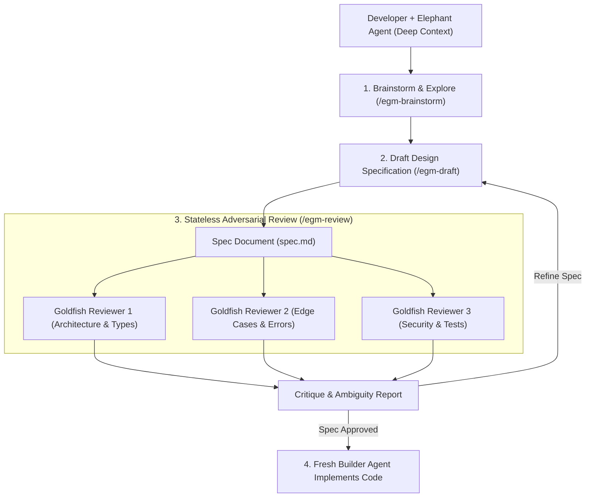
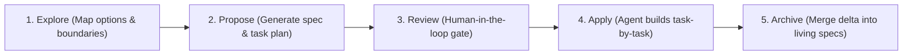

# Chapter 14: LLMs and AI-Powered Development

[← Previous: CI/CD](./13-ci-cd.md) | [Back to README](./README.md) | [Next: Putting It All Together →](./15-putting-it-together.md)

---

The way developers write code has changed fundamentally over the last few years. AI coding assistants and autonomous agents can now scaffold features, explain complex types, write unit tests, and execute multi-file refactors in seconds. At the same time, teams have learned that raw speed without structure leads to messy, fragile codebases — giving rise to **Spec-Driven Development (SDD)**.

This chapter introduces the modern landscape of AI development tools for TypeScript, explains how to structure AI workflows using specifications (including the **Elephant-Goldfish Model** and **OpenSpec**), and covers best practices for keeping your TypeScript codebase type-safe and maintainable.

## What Are LLMs and Coding Agents?

**Large Language Models** (LLMs) are AI systems trained on massive corpora of text and source code. Modern AI coding tools wrap these models in **agentic harnesses** that can read your repository, inspect `tsconfig.json`, execute terminal commands, and verify their own changes by running your type checker, linter, and test suite.



### How LLMs help TypeScript developers specifically

TypeScript's static type system creates a tight feedback loop for AI agents. Unlike dynamically typed languages where errors only surface at runtime, `tsc --noEmit` gives an AI agent immediate, deterministic feedback on whether its code fits your project's contracts. LLMs excel at:

- **Generating boilerplate**: Fastify route handlers, Drizzle/Prisma database schemas, and Zod validators
- **Explaining complex types**: walking through utility types like `ReturnType<typeof fn>`, conditional types, or deeply nested generics
- **Writing unit tests**: generating comprehensive Vitest suites covering edge cases and error branches
- **Suggesting refactors**: converting callbacks to `async/await`, extracting reusable hooks, or tightening `any` types into discriminated unions
- **Debugging type errors**: translating cryptic multi-line TypeScript compiler diagnostics into plain-English explanations and fixes

---

## The AI Coding Tooling Landscape

Today's TypeScript developers choose between AI-native editors and terminal-based coding agents — including [Claude Code](https://github.com/anthropics/claude-code), [Google Antigravity (`agy`)](https://antigravity.google/docs), [Grok Build](https://github.com/xai-org/grok-build), [Cursor](https://cursor.com), [GitHub Copilot CLI](https://github.com/github/copilot-cli), and [OpenAI Codex CLI](https://github.com/openai/codex).



| Tool | Primary Interface | Key Strengths | Official Link |
|---|---|---|---|
| **Cursor** | AI-first IDE (VSCode fork) | Inline `Cmd/Ctrl+K` edits, multi-line Tab completion, codebase-indexed Composer/Agent mode | [cursor.com](https://cursor.com) |
| **Claude Code** | Terminal CLI & IDE integration | Deep repo context, autonomous command execution, subagents, git-native workflows | [github.com/anthropics/claude-code](https://github.com/anthropics/claude-code) |
| **Google Antigravity (`agy`)** | CLI (`agy`), AI-first IDE & Desktop App | Multi-surface agent platform, subagents/swarms, sandboxed terminal execution, skills & MCP | [antigravity.google/docs](https://antigravity.google/docs) |
| **Grok Build** | Terminal CLI / TUI | Fast terminal-native coding agent powered by xAI's Grok models | [github.com/xai-org/grok-build](https://github.com/xai-org/grok-build) / [x.ai/cli](https://x.ai/cli) |
| **GitHub Copilot & Copilot CLI** | Editor extension & Terminal CLI | Ubiquitous inline completions, GitHub PR integration, shell command & workflow assistance | [github.com/features/copilot](https://github.com/features/copilot) / [github.com/github/copilot-cli](https://github.com/github/copilot-cli) |
| **OpenAI Codex CLI** | Terminal CLI & Cloud Agent | Lightweight open-source terminal agent (`codex`) with local sandbox execution | [github.com/openai/codex](https://github.com/openai/codex) |

---

## Cursor

[Cursor](https://cursor.com) is an AI-first code editor built on top of VSCode. If you already know VSCode, Cursor feels immediately familiar — all your extensions, themes, and keybindings carry over. The difference is that AI is deeply integrated into the editing experience rather than bolted on as an extension.

### Key features

- **`Cmd+K` / `Ctrl+K` — Inline AI editing**: Select a block of code, press `Ctrl+K`, and describe the change you want. Cursor edits the file in place with a reviewable diff.
- **`Cmd+L` / `Ctrl+L` — Codebase-aware chat**: Ask questions about your project ("how does authentication work in this repo?") and Cursor answers using your actual files, `tsconfig.json`, and imported types.
- **Tab completion**: Predicts multi-line edits and next cursor positions across files, completing entire function bodies or test blocks.
- **Agent mode**: Takes a multi-step goal, edits multiple files, runs `pnpm typecheck` and `pnpm test:run`, and iterates until checks pass.

### Example prompts for TypeScript development

```text
"Add a type-safe Fastify route for creating a user with TypeBox validation"
"Write Vitest tests for all functions in src/calculator.ts"
"Refactor this function to use a discriminated union instead of optional error fields"
"Explain what this complex TypeScript generic type produces"
```

---

## Claude Code

[Claude Code](https://github.com/anthropics/claude-code) is Anthropic's official agentic CLI that brings Claude directly to your terminal. Instead of being tied to a single editor, you interact with Claude from the command line while it explores your codebase, edits files, and runs verification commands.

### Key features

- **Terminal-native**: Works alongside Neovim, VSCode, Zed, JetBrains, or any editor.
- **Full project & Git awareness**: Reads project structure, configuration files (`CLAUDE.md`), and git history to draft commits, review diffs, or resolve merge conflicts.
- **Autonomous verification**: Runs `pnpm typecheck`, `pnpm lint`, and `pnpm test:run` after making edits, diagnosing and fixing failures before returning control.

### Installation and usage

Check the [Claude Code documentation](https://github.com/anthropics/claude-code) for the current native installer or package manager command:

```bash
npm install -g @anthropic-ai/claude-code
claude
```

Example one-shot workflows:

```bash
claude "Set up Vitest with V8 coverage thresholds at 80% for this project"
claude "Replace all explicit any types in src/ with strict TypeScript interfaces"
claude "Review src/routes/users.ts for unhandled promise rejections and type safety issues"
```

---

## Google Antigravity (`agy`), Codex, Grok Build, and Copilot CLI

Beyond Cursor and Claude Code, the ecosystem of agentic developer tools has expanded rapidly:

- **[Google Antigravity (`agy`)](https://antigravity.google/docs)**: Google's AI-first development platform spanning the `agy` CLI, Antigravity IDE, and Antigravity 2.0 desktop app. It supports sandboxed command execution, parallel subagents and multi-agent swarms (`/teamwork`), planning workflows (`/plan`, `/grill-me`), and extensible skills, rules, sidecars, and Model Context Protocol (MCP) servers.
- **[OpenAI Codex CLI](https://github.com/openai/codex)**: OpenAI's open-source terminal coding agent (`npm install -g @openai/codex`). It runs locally in your terminal, inspects your repo, proposes file patches, and executes commands in a configurable sandbox.
- **[Grok Build](https://github.com/xai-org/grok-build)** ([x.ai/cli](https://x.ai/cli)): xAI's open-source terminal coding agent and TUI that brings Grok models into your local development workflow for rapid code generation, refactoring, and debugging.
- **[GitHub Copilot](https://github.com/features/copilot) & [Copilot CLI](https://github.com/github/copilot-cli)**: GitHub's AI pair programmer integrates inline completions and chat into VSCode, JetBrains, and Neovim, while [GitHub Copilot CLI](https://docs.github.com/en/copilot/how-copilot-is-used/using-copilot-cli) brings terminal command explanations, shell script generation, and agentic task execution to the command line.

---

## Spec-Driven Development (SDD)

As AI coding agents became capable of generating hundreds of lines of TypeScript in seconds, developers discovered a new bottleneck: **prompting without structure produces technical debt at high speed**.

When you give an agent a vague one-line prompt like *"add user rate limiting to the API"*, the agent is forced to guess:
- Should rate limits be stored in memory, Redis, or PostgreSQL?
- What HTTP status code and JSON error format should be returned when a limit is exceeded?
- Are limits keyed by IP address, API key, or authenticated `userId`?

Because the agent guesses silently, you end up debugging AI-generated architecture after the fact.

**Spec-Driven Development (SDD)** solves this by flipping the workflow: **agree on *what* you are building in a structured, reviewable specification before the AI writes implementation code.**



### Why specs matter in AI-assisted development

1. **Catch mistakes when they are cheap**: Fixing a bad assumption in a 50-line Markdown spec takes 30 seconds; untangling it across 12 generated TypeScript files takes hours.
2. **Survive context resets**: Long chat sessions degrade as the context window fills up. A committed spec file acts as durable, reloadable memory across fresh agent sessions.
3. **Define clear verification criteria**: A good spec explicitly lists the types, edge cases, and test cases the agent must satisfy.

---

### The Elephant-Goldfish Model (EGM)

The **[Elephant-Goldfish Model (EGM)](https://egm.dev/)** is an open-source framework and methodology (originally outlined by Dave Rensin) designed to enforce high-quality Spec-Driven Development while keeping humans firmly in control.

EGM is built around a two-part memory metaphor that exploits how LLM context windows actually work:

1. **The Elephant (Long Context & Deep Planning)**:
   An "Elephant" agent session carries the long-horizon project history, architectural constraints, and trade-off discussions. You collaborate with the Elephant to brainstorm and draft a comprehensive design specification *before* any code is written (e.g., via `/egm-brainstorm` and `/egm-draft`).
2. **The Goldfish (Stateless, Fresh-Perspective Review)**:
   Once the draft spec is written, you do **not** ask the Elephant to review its own work — because the Elephant suffers from confirmation bias and remembers what you *meant* rather than what you actually *wrote*. Instead, EGM spawns brand-new, stateless **"Goldfish" sub-agents** (`/egm-review`) with **zero memory** of the brainstorming session.
   Each Goldfish reads the specification cold and acts as an adversarial reviewer — flagging ambiguities, missing edge cases, security gaps, and unstated assumptions.



By separating the **context-heavy planner (Elephant)** from **stateless reviewers and builders (Goldfish)**, [egm.dev](https://egm.dev/) ensures that your specification is self-contained and unambiguous enough for any fresh agent (or human teammate) to implement cleanly.

---

### OpenSpec

**[OpenSpec](https://openspec.dev/)** is another popular open-source, lightweight framework for Spec-Driven Development that works across AI coding tools (Claude Code, Cursor, Antigravity, Copilot, Codex, and others).

OpenSpec stores machine- and human-readable specifications directly in your repository (typically under an `openspec/` directory) and guides every feature or change through a structured **5-phase lifecycle**:



1. **Explore**: Think through the problem with your agent, inspect existing modules, and clarify constraints without writing production code.
2. **Propose**: The agent generates a change proposal containing the delta specification, architectural notes, and a checklist of implementation tasks.
3. **Review**: You review and refine the Markdown spec until every requirement and edge case is explicit.
4. **Apply**: The agent executes the tasks one by one against the approved spec, running `pnpm typecheck` and `pnpm test:run` at each step.
5. **Archive**: Once shipped, the change is archived and merged into the repository's living system specifications so future sessions inherit accurate context.

---

### Example Specification for a TypeScript Feature

Whether you use [EGM](https://egm.dev/), [OpenSpec](https://openspec.dev/), or plain Markdown files in a `specs/` folder, a strong TypeScript specification defines the **goal, non-goals, types/schemas, behavior, edge cases, and verification plan**.

Here is a practical example (`specs/001-password-reset-token.spec.md`):

````markdown
# Spec 001: Single-Use Password Reset Token Service

## 1. Goal & Context
Provide a type-safe service module (`src/auth/reset-token.ts`) that generates, hashes, and verifies short-lived, single-use password reset tokens using Node.js built-in `node:crypto`.

## 2. Non-Goals
- Sending emails (handled by `src/notifications/mailer.ts`)
- HTTP route registration (covered in Spec 002)

## 3. Data Types & Zod Schema
```typescript
import { z } from 'zod';

export const RequestResetInputSchema = z.object({
  email: z.string().email().transform((val) => val.toLowerCase().trim()),
});

export type RequestResetInput = z.infer<typeof RequestResetInputSchema>;

export interface ResetTokenRecord {
  id: string;
  userId: number;
  tokenHash: string; // SHA-256 hex digest of the raw token
  expiresAt: Date;
  usedAt: Date | null;
}

export type VerifyTokenResult =
  | { ok: true; userId: number }
  | { ok: false; reason: 'INVALID_TOKEN' | 'EXPIRED_TOKEN' | 'ALREADY_USED' };
```

## 4. Behavioral Requirements
1. `generateResetToken()` MUST generate 32 bytes of cryptographically secure random data (`crypto.randomBytes(32).toString('hex')`).
2. Raw tokens MUST NEVER be persisted; only the SHA-256 hex digest (`tokenHash`) is stored in the database.
3. Tokens expire exactly **15 minutes** (`900_000` ms) after creation.
4. `verifyAndConsumeToken(rawToken, now)`:
   - Hashes `rawToken` with SHA-256 and looks up the record.
   - Returns `{ ok: false, reason: 'INVALID_TOKEN' }` if no record matches.
   - Returns `{ ok: false, reason: 'ALREADY_USED' }` if `usedAt !== null`.
   - Returns `{ ok: false, reason: 'EXPIRED_TOKEN' }` if `now >= expiresAt`.
   - Atomically sets `usedAt = now` and returns `{ ok: true, userId }`.

## 5. Edge Cases & Security Constraints
- Empty or non-hex strings passed to `verifyAndConsumeToken` must return `INVALID_TOKEN` without throwing.
- Use `crypto.timingSafeEqual` when comparing digests in memory.
- No `any` types allowed; must compile under `strict: true`.

## 6. Verification & Acceptance Criteria
- [ ] `pnpm typecheck` passes with 0 errors
- [ ] `pnpm check:ci` passes with 0 lint/format warnings
- [ ] Unit tests in `src/auth/reset-token.test.ts` cover:
  - Happy path: valid unused token before expiry returns `{ ok: true, userId }`
  - Replay attack: calling `verifyAndConsumeToken` twice with the same token returns `ALREADY_USED` on the second call
  - Expiry boundary: token at `expiresAt` exact timestamp returns `EXPIRED_TOKEN`
  - Unknown/malformed token returns `INVALID_TOKEN`
````

Notice how little room for error this leaves: an AI agent given this spec knows the exact types, the security invariants, the error union cases, and the four unit tests it must write and pass.

---

## Best Practices for AI-Assisted TypeScript Development

AI tools are force multipliers, but they require disciplined engineering guardrails.

### 1. Always review generated TypeScript types

AI models can occasionally silence compiler errors by inserting `as any`, `as unknown as MyType`, or overly permissive union types. Treat your **types and schemas** as the highest-priority part of any code review. If the types and tests are right, errors in the implementation body are easy to catch.

### 2. Enforce strict compiler and linter rules

Your `tsconfig.json` (`strict: true`, `noUncheckedIndexedAccess: true`) and linter (`@typescript-eslint/no-explicit-any` or Biome's `noExplicitAny`) act as automated guardrails for AI agents. When an agent tries to take a shortcut with `any`, the linter immediately rejects it and forces the agent to write proper types.

### 3. Use Zod for runtime validation at boundaries

[Zod](https://zod.dev) is the library most TypeScript teams (and specs) reach for when validating **runtime** data at system boundaries — API request bodies, environment variables, form inputs, and LLM structured outputs. Because TypeScript types are erased at compile time, pairing a Zod schema with `z.infer<typeof Schema>` guarantees that your runtime validation and compile-time types never drift apart:

```typescript
import { z } from 'zod';

export const EnvSchema = z.object({
  NODE_ENV: z.enum(['development', 'test', 'production']).default('development'),
  PORT: z.coerce.number().int().positive().default(3000),
  DATABASE_URL: z.string().url(),
});

export type Env = z.infer<typeof EnvSchema>;
export const env: Env = EnvSchema.parse(process.env);
```

### 4. Keep context files (`AGENTS.md` / `CLAUDE.md`) concise

Most agentic tools read a repository instruction file (`AGENTS.md`, `CLAUDE.md`, or `.cursor/rules`) at the start of every session. Keep it short and actionable:

- Exact commands to build, typecheck, lint, and run a single test file (`pnpm vitest run src/path.test.ts`)
- Core stack choices (e.g., "Node 24 LTS, pnpm, Fastify, Drizzle, Biome — do not install Prettier or ESLint")
- Architectural boundaries and where specs live (`specs/` or `openspec/`)

### 5. Run your full verification suite after every change

Make it a non-negotiable habit — both for yourself and in your agent instructions — to run your check suite before committing:

```bash
pnpm typecheck   # catch static type errors
pnpm lint        # catch style and correctness issues
pnpm test:run    # verify runtime behavior and edge cases
```

---

## How This Guide Was Built and Maintained with AI

The initial draft of this tutorial — chapters, README, and the `prompts.md` outline — was generated with [Claude Code](https://github.com/anthropics/claude-code), and later reviewed and expanded using [Google Antigravity (`agy`)](https://antigravity.google/docs):

1. A structured `prompts.md` specification described every chapter and topic.
2. Parallel agents generated the initial Markdown chapters.
3. Subsequent human and agent review passes added architectural Mermaid diagrams, updated Node 22/24 LTS and tooling guidance, and expanded coverage of modern agentic workflows and Spec-Driven Development.

AI drafts are a starting point, not a substitute for verification — always check official documentation for fast-moving tools.

---

## What's Next?

You now have a complete modern toolkit: TypeScript, testing, linting, databases, CI/CD, and spec-driven AI workflows. In the next chapter, we put everything together by building a complete project from scratch — applying each tool in the right order.

[← Previous: CI/CD](./13-ci-cd.md) | [Back to README](./README.md) | [Next: Putting It All Together →](./15-putting-it-together.md)
