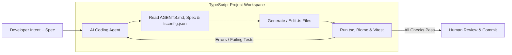
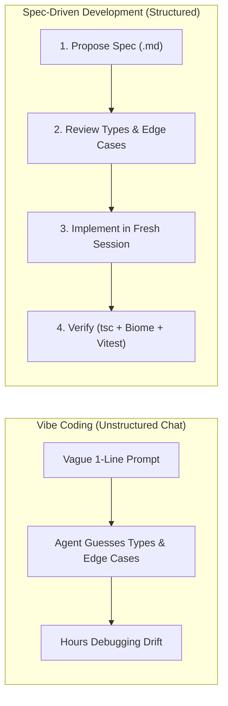

# Chapter 14: LLMs and AI-Powered Development

[← Previous: CI/CD](./13-ci-cd.md) | [Back to README](./README.md) | [Next: Putting It All Together →](./15-putting-it-together.md)

---

A few years ago, "AI-assisted coding" meant tab-completing a `for` loop. Today, autonomous coding agents can read your entire repository, write a Fastify route, generate Vitest tests, and run `tsc --noEmit` to verify their own work while you sip your coffee.

There's just one catch: an AI agent can also generate 1,500 lines of spaghetti code in 12 seconds if you don't give it clear boundaries. This chapter covers the modern AI coding toolkit, **Spec-Driven Development (SDD)**, and a clear path so you know what to use at each stage of your projects.



---

## The AI Coding Toolkit

AI tools evolve fast, so always check their official docs for current setup and pricing. **You only need one editor integration or one terminal agent to start:**

### 1. AI-First Editors & IDE Extensions
- **[GitHub Copilot](https://github.com/features/copilot)** ([docs](https://docs.github.com/en/copilot)): The classic AI pair programmer for VSCode, JetBrains, and Neovim. Great for inline completions, multi-file agent edits, and PR reviews — and **100% free for verified students** via the [GitHub Student Developer Pack](https://education.github.com/pack).
- **[Cursor](https://cursor.com)** ([docs](https://cursor.com/docs)): A fork of VSCode with codebase-indexed chat, inline diff edits (`Cmd/Ctrl+K`), and multi-file agent mode built into the editor.

### 2. Terminal & Autonomous Coding Agents
- **[Claude Code](https://github.com/anthropics/claude-code)** ([docs](https://docs.anthropic.com/en/docs/claude-code)): Anthropic's terminal coding agent (`curl -fsSL https://claude.ai/install.sh | bash` or `npm install -g @anthropic-ai/claude-code`, then run `claude`). Reads your repo, edits files, runs `pnpm typecheck` and `vitest`, and iterates until checks pass.
- **[Google Antigravity (`agy`)](https://antigravity.google/docs)**: Google's agentic development platform spanning the `agy` CLI and Antigravity IDE, with sandboxed execution, subagents, skills, and MCP servers.
- **[OpenAI Codex CLI](https://github.com/openai/codex)**: OpenAI's open-source terminal agent (`npm install -g @openai/codex`) that inspects your repo and runs verification commands locally.
- **[GitHub Copilot CLI](https://github.com/github/copilot-cli)**: Brings GitHub Copilot's agent workflows directly into your terminal.
- **[Grok Build](https://github.com/xai-org/grok-build)** ([x.ai/cli](https://x.ai/cli)): xAI's terminal coding agent powered by Grok models.

---

## Spec-Driven Development (SDD): Why Chat History Isn't Enough

Typing *"build me a user auth system"* into an AI prompt and hitting Enter is called **vibe coding**. It feels magical for 10 minutes — and then you spend 4 hours debugging hallucinated database columns and inconsistent error types.

Why does vibe coding break down? Because **every new AI session starts with zero memory of your project**, and during long back-and-forth chats the context window fills up and drifts.

**Spec-Driven Development (SDD)** fixes this by moving your project rules and feature designs out of ephemeral chat history and into version-controlled Markdown files:

1. **Repo Memory (`AGENTS.md` / `CLAUDE.md`)**: A short 15-line file in your repo root listing your stack (Node 24, pnpm, Biome, Vitest), commands (`pnpm ci`), and rules (`noExplicitAny`).
2. **Feature Specifications (`specs/` or `openspec/`)**: A short Markdown contract defining the goal, TypeScript types/schemas, edge cases, and acceptance criteria *before* any `.ts` implementation file is written.
3. **Deterministic Verification**: Clear the noisy chat (`/clear`) after drafting the spec, let the agent implement against the written spec, and let `tsc --noEmit`, Biome, and Vitest act as the referee.



---

### The SDD Ecosystem: OpenSpec, Spec Kit, EGM & Agent Skills

You can practice SDD with plain Markdown files in a `specs/` folder, or use open-source toolkits that standardize the workflow across your coding agents:

#### 1. OpenSpec — Lightweight SDD for New & Existing TypeScript Projects
**[OpenSpec](https://openspec.dev/)** ([`Fission-AI/OpenSpec`](https://github.com/Fission-AI/OpenSpec)) is a lightweight, open-source SDD framework that works across 30+ AI coding tools (Claude Code, Cursor, GitHub Copilot, `agy`, Codex, and more). It shines on both brand-new projects and existing ("brownfield") codebases by separating **current system specs** from **isolated change proposals**:

```text
openspec/
├── config.yaml                  # Project stack & conventions
├── specs/                       # Living source of truth (how the app works today)
└── changes/
    └── add-reset-token/         # Isolated folder for one proposed feature
        ├── proposal.md          # Why we're making this change & scope boundaries
        ├── specs/               # Delta specs (ADDED / MODIFIED / REMOVED requirements)
        ├── design.md            # TypeScript types, schemas & architecture notes
        └── tasks.md             # Step-by-step implementation checklist
```

**Quick setup & commands:**
```bash
npm install -g @fission-ai/openspec@latest
cd my-ts-app
openspec init
```
Inside your AI agent's chat, you drive each feature with slash commands:
- **`/opsx:propose <feature>`** *(or `/opsx:explore` first)* — Drafts `proposal.md`, delta `specs/`, `design.md`, and `tasks.md` for your review before touching `src/`.
- **`/opsx:apply`** — Executes the checklist in `tasks.md` step by step.
- **`/opsx:archive`** — Merges the completed delta specs into `openspec/specs/` once tests pass.

#### 2. Pointers to Spec Kit, EGM & Addy Osmani's `agent-skills`

Three other open-source projects pair well with OpenSpec as your projects grow:

- **[GitHub Spec Kit (`spec-kit`)](https://github.com/github/spec-kit)** ([speckit.org](https://speckit.org/)): GitHub's open-source SDD toolkit that guides greenfield apps and features through a structured pipeline (`/speckit.constitution` → `/speckit.specify` → `/speckit.plan` → `/speckit.tasks` → `/speckit.implement`).
- **[EGM — Elephant–Goldfish Model](https://egm.dev/)**: An open-source SDD methodology and plugin suite that separates deep-context spec drafting from stateless, zero-context reviewer subagents (`/egm-review`) that cold-audit specs for blind spots before coding begins.
- **[Addy Osmani's `agent-skills`](https://github.com/addyosmani/agent-skills)** ([agenticskills.io](https://agenticskills.io/), [blog](https://addyosmani.com/)): While **[OpenSpec](https://github.com/Fission-AI/OpenSpec)**, **[Spec Kit](https://github.com/github/spec-kit)**, and **[EGM](https://egm.dev/)** define *what* to build and manage your specification artifacts, Addy Osmani's `agent-skills` complement them by teaching your agent *how* to execute each engineering step like a senior developer — providing portable `SKILL.md` playbooks and slash commands (`/spec`, `/plan`, `/build`, `/test`, `/review`) for test-first implementation, code simplification, security hardening, and web performance.

---

## Student Roadmap: Which Setup Should You Use?

Don't install five frameworks just to finish a homework assignment! Follow this progression based on what you're building:

| Your Stage | Recommended Setup | Workflow |
|------------|-------------------|----------|
| **1. Class Assignments & Small Scripts** *(Start here!)* | **VSCode + GitHub Copilot** (free via [Student Pack](https://education.github.com/pack)) or **Claude Code** / **Cursor** + a 15-line `AGENTS.md` | Write specific prompts with explicit TypeScript types, ask the AI to explain unfamiliar syntax, and run `pnpm typecheck && pnpm test` yourself. |
| **2. Hackathons, Group Projects & Capstones** | Add a **`specs/` folder** *or* run **`openspec init`** ([OpenSpec](https://openspec.dev/)) | Draft a 1-page spec (`specs/<feature>.spec.md` or `/opsx:propose`) so teammates and agents agree on types and edge cases before coding. |
| **3. Internships & Production Codebases** | **[OpenSpec](https://github.com/Fission-AI/OpenSpec)** or **[Spec Kit](https://github.com/github/spec-kit)** + **[Addy Osmani's `agent-skills`](https://github.com/addyosmani/agent-skills)** + **[EGM](https://egm.dev/)** | Use OpenSpec/Spec Kit for change specs, `agent-skills` (and [Modern Web Guidance](https://github.com/googlechrome/modern-web-guidance)) for senior implementation habits, and EGM for cold spec reviews. |

---

### Example Specification (`specs/001-reset-token.spec.md`)

Whether you write specs by hand in `specs/` or generate them with `/opsx:propose`, here is what a crisp TypeScript spec looks like:

````markdown
# Spec 001: Single-Use Password Reset Token Service

## 1. Goal & Non-Goals
- **Goal**: Create `src/auth/reset-token.ts` to generate, hash, and verify single-use password reset tokens using `node:crypto`.
- **Non-Goals**: Sending emails or HTTP route wiring.

## 2. Types & Zod Schema
```typescript
import { z } from 'zod';

export const ResetEmailSchema = z.object({
  email: z.string().email().transform((s) => s.toLowerCase().trim()),
});

export type VerifyTokenResult =
  | { ok: true; userId: number }
  | { ok: false; reason: 'INVALID_TOKEN' | 'EXPIRED_TOKEN' | 'ALREADY_USED' };
```

## 3. Rules & Edge Cases
1. `generateResetToken()` returns 32 random bytes as hex (`crypto.randomBytes(32).toString('hex')`).
2. Store only the SHA-256 hex digest in the DB — never the raw token.
3. Tokens expire after **15 minutes** (`900_000` ms) and can only be consumed once.
4. Empty or non-hex inputs return `{ ok: false, reason: 'INVALID_TOKEN' }` without throwing.

## 4. Acceptance Criteria
- [ ] `pnpm typecheck` and `pnpm check` pass with 0 errors
- [ ] `src/auth/reset-token.test.ts` tests happy path, replay (`ALREADY_USED`), expiry (`EXPIRED_TOKEN`), and bad input (`INVALID_TOKEN`)
````

> **Quick pointer on [Zod](https://zod.dev):** Notice `z.object(...)` in the spec above? TypeScript types vanish at runtime, so libraries like Zod validate untrusted data (API bodies, `.env` vars, LLM outputs) at runtime *and* infer the static TypeScript type (`z.infer<typeof Schema>`) from a single definition.

---

## Golden Rules for AI-Assisted TypeScript

1. **Review the types and tests first**: If an agent sneaks `as any` into your code to silence `tsc`, reject it. Strong types + strict linter rules (`noExplicitAny`) keep agents honest.
2. **Keep an `AGENTS.md` / `CLAUDE.md` file in your repo root**: Give agents a 15-line cheat sheet listing your stack (Node 24, pnpm, Biome, Vitest) and exact verification commands.
3. **Always run the check suite yourself before committing**:
   ```bash
   pnpm typecheck && pnpm check && pnpm test:run
   ```

*(Fun fact: This guide itself was drafted from [prompts.md](./prompts.md) using [Claude Code](https://github.com/anthropics/claude-code) and refined with [Google Antigravity (`agy`)](https://antigravity.google/docs)!)*

---

## What's Next?

In [Chapter 15: Putting It All Together](./15-putting-it-together.md), we'll assemble a clean, zero-bloat TypeScript project from scratch — wiring up `tsconfig.json`, Biome, Vitest, GitHub Actions CI, and optional AI guardrails.

[← Previous: CI/CD](./13-ci-cd.md) | [Back to README](./README.md) | [Next: Putting It All Together →](./15-putting-it-together.md)
