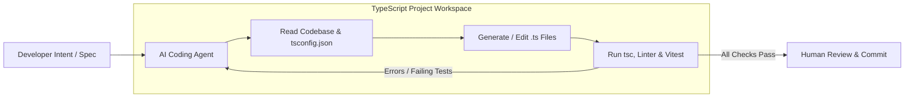
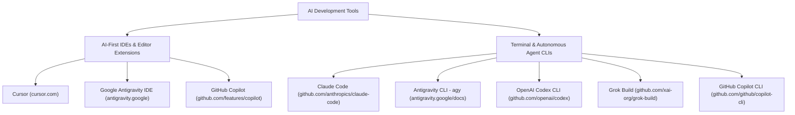
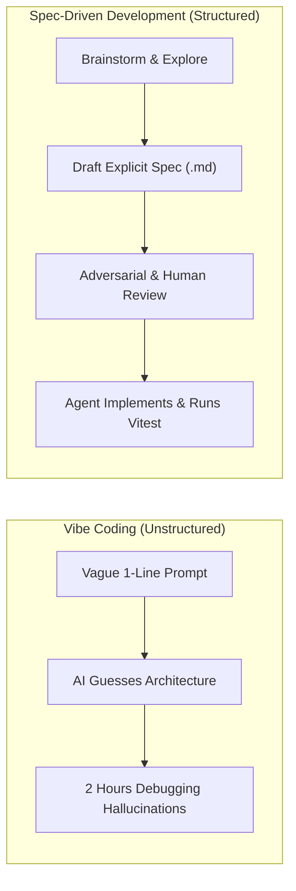
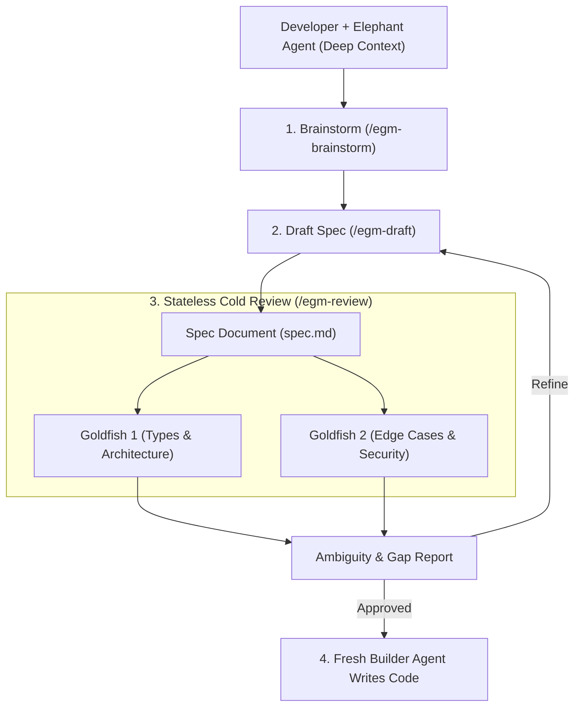
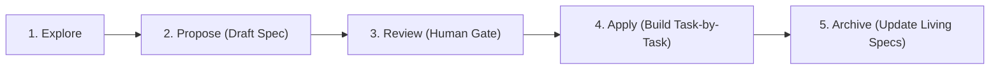

# Chapter 14: LLMs and AI-Powered Development

[← Previous: CI/CD](./13-ci-cd.md) | [Back to README](./README.md) | [Next: Putting It All Together →](./15-putting-it-together.md)

---

A few years ago, "AI-assisted coding" meant tab-completing a `for` loop. Today, autonomous coding agents can read your entire repository, write a Fastify route, generate Vitest tests, and run `tsc --noEmit` to verify their own work while you sip your coffee.

There's just one catch: an AI agent can also generate 1,500 lines of spaghetti code in 12 seconds if you don't give it clear boundaries. This chapter covers the modern AI coding toolkit and **Spec-Driven Development (SDD)** — the workflow that keeps you in the driver's seat.



---

## The AI Coding Toolkit

Today's TypeScript developers choose between AI-native editors and terminal-based coding agents — including [Claude Code](https://github.com/anthropics/claude-code), [Google Antigravity (`agy`)](https://antigravity.google/docs), [Grok Build](https://github.com/xai-org/grok-build), [Cursor](https://cursor.com), [GitHub Copilot CLI](https://github.com/github/copilot-cli), and [OpenAI Codex CLI](https://github.com/openai/codex).



### AI-First Editors & Extensions

- **[Cursor](https://cursor.com)**: A fork of VSCode with AI baked into every shortcut. Use `Cmd/Ctrl+K` for inline edits, `Tab` for multi-line predictions across files, and Agent mode to let it edit files and run your type checker automatically.
- **[GitHub Copilot](https://github.com/features/copilot)**: The classic AI pair programmer for VSCode, JetBrains, and Neovim. Great for inline ghost-text completions, PR summaries, and repetitive test cases (plus it's **free for verified students** via GitHub Education!).

### Terminal & Multi-Agent Harnesses

- **[Claude Code](https://github.com/anthropics/claude-code)**: Anthropic's terminal-native coding agent (`npm install -g @anthropic-ai/claude-code`, then run `claude`). It reads your repo, runs Vitest and `tsc`, spawns subagents, and commits changes right from your shell.
- **[Google Antigravity (`agy`)](https://antigravity.google/docs)**: Google's agentic development platform spanning the `agy` CLI, Antigravity IDE, and desktop app. Supports sandboxed command execution, multi-agent swarms (`/teamwork`), interactive spec grilling (`/grill-me`, `/plan`), and extensible skills and MCP servers.
- **[OpenAI Codex CLI](https://github.com/openai/codex)**: OpenAI's lightweight open-source terminal agent (`npm install -g @openai/codex`) that inspects your repo and runs commands in a local sandbox.
- **[Grok Build](https://github.com/xai-org/grok-build)** ([x.ai/cli](https://x.ai/cli)): xAI's fast terminal-based coding agent and TUI powered by Grok models.
- **[GitHub Copilot CLI](https://github.com/github/copilot-cli)** ([docs](https://docs.github.com/en/copilot/how-copilot-is-used/using-copilot-cli)): Brings GitHub Copilot to your terminal to explain shell flags, write bash/git commands, and run agentic tasks.

### Recommendations

- **If you want an all-in-one visual editor:** Start with **Cursor** or **VSCode + GitHub Copilot** (especially if you have free student access).
- **If you love the terminal or want autonomous multi-file execution:** Pair your editor with **Claude Code**, **Google Antigravity (`agy`)**, **Codex CLI**, or **Grok Build**.

---

## Spec-Driven Development (SDD)

Typing *"build me a user auth system"* into an AI prompt and hitting Enter is called **vibe coding**. It feels magical for 10 minutes — and then you spend 4 hours debugging hallucinated database columns and inconsistent error types.

**Spec-Driven Development (SDD)** fixes this by treating a short **Markdown specification** as the contract between you and the AI *before* any implementation code is written. Fixing a bad assumption in a 40-line spec takes 20 seconds; fixing it across 10 generated TypeScript files takes all afternoon.



### The Elephant-Goldfish Model (EGM)

The **[Elephant-Goldfish Model (EGM)](https://egm.dev/)** is an open-source framework (created by Dave Rensin) that uses a clever two-part memory metaphor to keep AI agents honest:

1. **The Elephant (Long Context & Planning)**: A deep-context session that remembers all your brainstorming notes, trade-offs, and architecture. You work with the Elephant to draft the spec (`/egm-brainstorm`, `/egm-draft`).
2. **The Goldfish (Stateless Adversarial Review)**: If you ask the Elephant to review its own spec, it suffers from confirmation bias — it remembers what you *meant*, not what it *wrote*. Instead, EGM spawns brand-new, stateless **Goldfish sub-agents** (`/egm-review`) with **zero memory** of your conversation. They read the spec cold and ruthlessly flag ambiguities, missing edge cases, and security holes before a single `.ts` file is touched.



### OpenSpec

**[OpenSpec](https://openspec.dev/)** is another popular, lightweight open-source SDD framework that stores specs right in your repo (`openspec/`) and works across Claude Code, Cursor, `agy`, Copilot, and Codex. Every feature follows a clean 5-step loop:



### Example Specification (`specs/001-reset-token.spec.md`)

Here is what a crisp, junior-friendly TypeScript spec looks like in practice:

````markdown
# Spec 001: Single-Use Password Reset Token Service

## 1. Goal & Non-Goals
- **Goal**: Create `src/auth/reset-token.ts` to generate, hash, and verify single-use password reset tokens using `node:crypto`.
- **Non-Goals**: Sending emails or HTTP route wiring.

## 2. Types & Zod Schema
```typescript
import { z } from 'zod';

export const ResetEmailSchema = z.object({
  email: z.string().email().transform((s) => s.toLowerCase().trim()),
});

export type VerifyTokenResult =
  | { ok: true; userId: number }
  | { ok: false; reason: 'INVALID_TOKEN' | 'EXPIRED_TOKEN' | 'ALREADY_USED' };
```

## 3. Rules & Edge Cases
1. `generateResetToken()` returns 32 random bytes as hex (`crypto.randomBytes(32).toString('hex')`).
2. Store only the SHA-256 hex digest in the DB — never the raw token.
3. Tokens expire after **15 minutes** (`900_000` ms) and can only be consumed once.
4. Empty or non-hex inputs return `{ ok: false, reason: 'INVALID_TOKEN' }` without throwing.

## 4. Acceptance Criteria
- [ ] `pnpm typecheck` and `pnpm check:ci` pass with 0 errors
- [ ] `src/auth/reset-token.test.ts` tests happy path, replay (`ALREADY_USED`), expiry (`EXPIRED_TOKEN`), and bad input (`INVALID_TOKEN`)
````

> **Quick pointer on [Zod](https://zod.dev):** Notice `z.object(...)` in the spec above? TypeScript types vanish at runtime, so libraries like Zod validate untrusted data (API bodies, `.env` vars, LLM outputs) at runtime *and* infer the static TypeScript type (`z.infer<typeof Schema>`) from a single definition.

---

## Golden Rules for AI-Assisted TypeScript

1. **Review the types and tests first**: If an agent sneaks `as any` into your code to silence `tsc`, reject it. Strong types + strict linter rules (`noExplicitAny`) keep agents honest.
2. **Keep an `AGENTS.md` / `CLAUDE.md` file in your repo root**: Give agents a 15-line cheat sheet listing your stack (Node 24, pnpm, Biome, Vitest) and exact verification commands.
3. **Always run the check suite before committing**:
   ```bash
   pnpm typecheck && pnpm lint && pnpm test:run
   ```

*(Fun fact: This guide itself was drafted from [prompts.md](./prompts.md) using [Claude Code](https://github.com/anthropics/claude-code) and refined with [Google Antigravity (`agy`)](https://antigravity.google/docs)!)*

---

## What's Next?

In [Chapter 15: Putting It All Together](./15-putting-it-together.md), we'll build a complete TypeScript project from scratch — starting with a spec, wiring up modern web guidance, and pushing to a live GitHub Actions pipeline.

[← Previous: CI/CD](./13-ci-cd.md) | [Back to README](./README.md) | [Next: Putting It All Together →](./15-putting-it-together.md)
