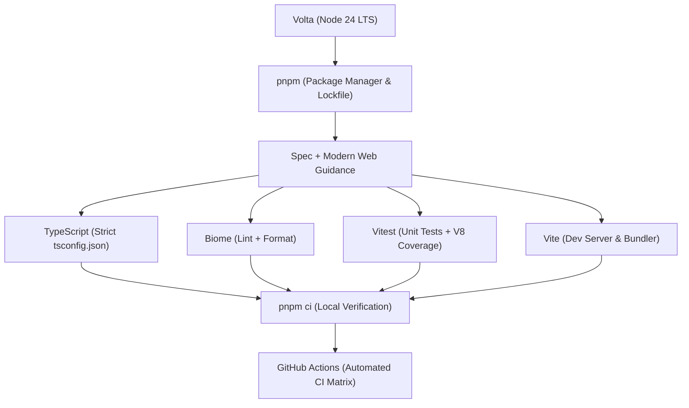

# Chapter 15: Putting It All Together

[← Previous: LLMs and AI-Powered Development](./14-llms.md) | [Back to README](./README.md) | [Next: Using This Setup for JavaScript Projects →](./16-javascript.md)

---

You've met all the individual tools. Now let's assemble them into a single, cohesive TypeScript project from scratch — the kind of repo you can proudly link on your resume or use as a starter template for hackathons and side projects.



---

## Step 1: Pin Node.js with Volta & Scaffold with Vite

Install Volta (if you haven't yet) and scaffold a clean `vanilla-ts` Vite project:

```bash
curl https://get.volta.sh | bash
volta install node@24

pnpm create vite my-typescript-app -- --template vanilla-ts
cd my-typescript-app
volta pin node@24
pnpm install
```

---

## Step 2: Lock Down `tsconfig.json`

Replace the starter `tsconfig.json` with a strict configuration that catches `undefined` array indexing and implicit returns before they bite you:

```json
{
  "compilerOptions": {
    "target": "ES2022",
    "module": "ESNext",
    "moduleResolution": "Bundler",
    "strict": true,
    "noUncheckedIndexedAccess": true,
    "exactOptionalPropertyTypes": true,
    "noImplicitReturns": true,
    "noFallthroughCasesInSwitch": true,
    "skipLibCheck": true,
    "outDir": "./dist",
    "rootDir": "./src"
  },
  "include": ["src/**/*"],
  "exclude": ["node_modules", "dist"]
}
```

---

## Step 3: Set Up Biome for Linting & Formatting

One tool, one config file, zero tabs-vs-spaces drama:

```bash
pnpm add -D @biomejs/biome
pnpm biome init
```

---

## Step 4: Set Up Vitest with Coverage

```bash
pnpm add -D vitest @vitest/coverage-v8
```

Create `vitest.config.ts`:

```typescript
import { defineConfig } from 'vitest/config';

export default defineConfig({
  test: {
    globals: true,
    environment: 'node',
    coverage: {
      provider: 'v8',
      reporter: ['text', 'html'],
      thresholds: { lines: 80 },
    },
  },
});
```

---

## Step 5: Add Modern Web Guidance for Frontend & AI Agents

Before writing frontend HTML/CSS/TS (or letting an AI agent generate it), there's a common trap: LLMs were trained on years of legacy Stack Overflow answers, so left to their own devices they'll happily build a 300-line custom React modal instead of using the native HTML `<dialog>` element.

**[Google Chrome's Modern Web Guidance](https://github.com/googlechrome/modern-web-guidance)** is an open-source reference and AI agent skill/plugin maintained by the Chrome team that teaches both humans and coding agents modern Baseline web APIs — including native `<dialog>` and Popover API, CSS container queries, View Transitions, Core Web Vitals (LCP, INP, CLS), accessibility, and security best practices.

When working on any web UI in your TypeScript project:

- Bookmark [github.com/googlechrome/modern-web-guidance](https://github.com/googlechrome/modern-web-guidance) to check modern HTML/CSS/DOM patterns first.
- Install it as a skill/plugin in your AI coding agent (`claude`, `agy`, Cursor) so the agent queries current web standards instead of hallucinating 2016 workarounds.

---

## Step 6: Write the Specification First (Spec-Driven Development)

Following the Spec-Driven Development workflow from [Chapter 14](./14-llms.md), let's write a quick, unambiguous spec in `specs/calculator.spec.md` *before* writing code (or handing the task to an AI agent):

````markdown
# Spec: Safe Calculator Module (`src/calculator.ts`)

## 1. Goal
Implement a pure, strictly typed arithmetic module (`src/calculator.ts`) with unit tests (`src/calculator.test.ts`).

## 2. Public API & Types
```typescript
export function add(a: number, b: number): number;
export function divide(a: number, b: number): number;
export function calculatePercentage(part: number, whole: number): number;
```

## 3. Behavioral Rules & Edge Cases
- `add(a, b)` returns the sum of `a` and `b`.
- `divide(a, b)` returns `a / b`. If `b === 0`, throw `new Error('Cannot divide by zero')`.
- `calculatePercentage(part, whole)` returns `(part / whole) * 100` rounded to 2 decimal places. If `whole === 0`, throw `new Error('Whole cannot be zero')`.
- No `any` types allowed; must pass `tsc --noEmit` with `strict: true`.

## 4. Verification Criteria
- [ ] `pnpm typecheck` passes
- [ ] `pnpm check:ci` passes with 0 Biome warnings
- [ ] `pnpm test:coverage` passes with >= 80% line coverage, testing happy paths and zero-division throws
````

---

## Step 7: Implement the Code and Tests

Now implement `src/calculator.ts` directly from the spec:

```typescript
export function add(a: number, b: number): number {
  return a + b;
}

export function divide(a: number, b: number): number {
  if (b === 0) throw new Error('Cannot divide by zero');
  return a / b;
}

export function calculatePercentage(part: number, whole: number): number {
  if (whole === 0) throw new Error('Whole cannot be zero');
  return Math.round((part / whole) * 10000) / 100;
}
```

And `src/calculator.test.ts`:

```typescript
import { describe, it, expect } from 'vitest';
import { add, divide, calculatePercentage } from './calculator';

describe('calculator', () => {
  it('adds numbers', () => expect(add(2, 3)).toBe(5));
  it('divides numbers', () => expect(divide(10, 2)).toBe(5));
  it('throws on divide by zero', () => {
    expect(() => divide(1, 0)).toThrow('Cannot divide by zero');
  });
  it('calculates percentage rounded to 2 decimal places', () => {
    expect(calculatePercentage(1, 3)).toBe(33.33);
    expect(() => calculatePercentage(5, 0)).toThrow('Whole cannot be zero');
  });
});
```

---

## Step 8: Wire Up `package.json` Scripts, Git & CI

Update the `"scripts"` section of `package.json` with a single `"ci"` command that runs every check in order:

```json
"scripts": {
  "dev": "vite",
  "build": "tsc --noEmit && vite build",
  "preview": "vite preview",
  "test": "vitest",
  "test:run": "vitest run",
  "test:coverage": "vitest run --coverage",
  "lint": "biome lint .",
  "format": "biome format --write .",
  "check": "biome check --write .",
  "check:ci": "biome check .",
  "typecheck": "tsc --noEmit",
  "ci": "pnpm typecheck && pnpm check:ci && pnpm test:coverage && pnpm build"
}
```

Create `.gitignore`:

```gitignore
node_modules/
dist/
coverage/
.env
.env.*.local
.DS_Store
*.tsbuildinfo
```

Add `.github/workflows/ci.yml` (from [Chapter 13](./13-ci-cd.md)), run `pnpm ci` locally to verify everything is green, and push to GitHub:

```bash
pnpm ci
git init && git add .
git commit -m "Initial TypeScript project setup from spec"
gh repo create my-typescript-app --public --source=. --remote=origin --push
```

> **Want to skip the setup next time?** Turn your repo into a GitHub Template, or check out [cookiecutter-typescript-library](https://github.com/amitsk/cookiecutter-typescript-library). You can also add [lefthook](https://github.com/evilmartians/lefthook) or [Husky](https://typicode.github.io/husky/) to run `pnpm check:ci` automatically on `git commit`.

---

## What's Next?

Next, [Chapter 16](./16-javascript.md) shows how to use this exact same toolchain for plain JavaScript projects with JSDoc, and [Chapter 17](./17-aws-lambda.md) takes TypeScript serverless with AWS Lambda.

[← Previous: LLMs and AI-Powered Development](./14-llms.md) | [Back to README](./README.md) | [Next: Using This Setup for JavaScript Projects →](./16-javascript.md)
