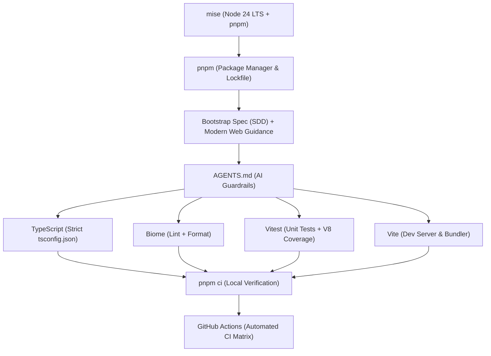

# Chapter 15: Putting It All Together

[← Previous: LLMs and AI-Powered Development](./14-llms.md) | [Back to README](./README.md) | [Next: Using This Setup for JavaScript Projects →](./16-javascript.md)

---

You've met all the individual tools. Now let's assemble them into a single, cohesive TypeScript project from scratch — the kind of repo you can proudly link on your resume or use as a starter template for hackathons and side projects.



---

## Step 0: Write the Bootstrap Spec First

Treat the setup itself as a feature: write `specs/000-bootstrap.spec.md` before running commands or handing the task to an AI agent. This is the same Spec-Driven Development (SDD) idea from [Chapter 14](./14-llms.md), and it captures every decision below so a teammate — or a fresh agent session — can reproduce the repo without guessing.

````markdown
# Spec 000: TypeScript Project Bootstrap

## 1. Goal & Non-Goals
- **Goal**: Create a reproducible TypeScript app repo with Node 24 LTS, pnpm, strict
  types, linting/formatting, tests with coverage, a Vite build, and GitHub Actions CI.
- **Non-Goals**: Product features, deployment, database, authentication.

## 2. Toolchain
| Concern        | Choice                                                           |
| -------------- | ---------------------------------------------------------------- |
| Runtime        | Node.js 24 LTS, pinned with mise (`.mise.toml`)                  |
| Packages       | pnpm 10 with a committed `pnpm-lock.yaml`                        |
| Language       | TypeScript, ESM (`"type": "module"`), `"strict": true`           |
| Build/dev      | Vite (`vanilla-ts` template)                                     |
| Lint + format  | Biome                                                            |
| Tests          | Vitest + V8 coverage (>= 80% lines)                              |
| CI             | GitHub Actions on Node 22 and Node 24                            |
| AI workflow    | `AGENTS.md` + `specs/` (SDD); optional EGM Goldfish review       |

## 3. Required Files
```text
.mise.toml
.github/workflows/ci.yml
AGENTS.md
biome.json
package.json
pnpm-lock.yaml
specs/000-bootstrap.spec.md
src/main.ts
tsconfig.json
vitest.config.ts
.gitignore
README.md
```

## 4. Configuration Requirements
- `.mise.toml` pins `node = "24"` and `pnpm = "10"`; a fresh clone runs `mise install`.
- `tsconfig.json`: `target: ES2022`, `module: ESNext`, `moduleResolution: Bundler`,
  `strict: true`, `noUncheckedIndexedAccess`, `exactOptionalPropertyTypes`,
  `noImplicitReturns`, `noFallthroughCasesInSwitch`; include `src/**/*`, exclude
  `node_modules` and `dist`.
- `package.json` scripts: `dev`, `build` (`tsc --noEmit && vite build`), `test`,
  `test:coverage`, `lint`, `format`, `format:check`, `check`, `check:ci`, `typecheck`,
  and `ci`. `pnpm ci` runs typecheck -> Biome check -> coverage tests -> build and must pass.
- `vitest.config.ts`: Node environment, V8 coverage, `text` + `html` reporters,
  80% line threshold.
- `.gitignore`: `node_modules/`, `dist/`, `coverage/`, `.env*`, `.DS_Store`,
  `*.tsbuildinfo`.
- `AGENTS.md` documents the stack, exact commands, and non-negotiable rules
  (no `any` or `@ts-ignore`, tests for every behavior change).
- `.github/workflows/ci.yml` runs `pnpm install --frozen-lockfile`, typecheck, Biome,
  coverage tests, and build on Node 22 and 24.

## 5. Web UI & AI Guardrails
- Consult Chrome's Modern Web Guidance before writing UI; prefer Baseline APIs
  (`<dialog>`, Popover, container queries) over legacy workarounds.
- Every feature gets `specs/NNN-name.spec.md` with goal, public API/types, edge cases,
  and acceptance criteria before implementation.
- Keep `AGENTS.md` short and current; agents must run `pnpm ci` before proposing a change.
- For risky specs, run an Elephant-Goldfish Model (EGM) cold review: a stateless
  "Goldfish" agent reads the spec cold and reports gaps before code is written.

## 6. Acceptance Criteria
- [ ] `mise install && pnpm install` works from a fresh clone.
- [ ] `pnpm ci` exits 0.
- [ ] Coverage report shows >= 80% lines.
- [ ] `pnpm build` produces `dist/`.
- [ ] Pushing to GitHub triggers a green CI run on Node 22 and Node 24.
- [ ] A second developer (or agent) can follow `README.md` + `AGENTS.md` without
      asking setup questions.
````

The remaining steps implement this spec.

---

## Step 1: Pin Node.js with mise & Scaffold with Vite

[mise](https://mise.jdx.dev) is a fast, polyglot version manager: one `.mise.toml` pins Node.js (plus pnpm, Python, Go, or anything else the project needs), and every teammate gets the same versions automatically.

Install mise and scaffold a clean `vanilla-ts` Vite project:

```bash
curl https://mise.run | sh
# Restart your shell once so mise's shims are on your PATH
mise use --global node@24 pnpm@10

pnpm create vite my-typescript-app -- --template vanilla-ts
cd my-typescript-app
mise use node@24 pnpm@10   # writes .mise.toml for this project
pnpm install
```

Commit the generated `.mise.toml`:

```toml
[tools]
node = "24"
pnpm = "10"
```

Anyone who clones the repo runs `mise install` (run `mise trust` once if mise asks) and gets identical Node and pnpm versions — no `nvm use`, no "works on my machine". If you are not sure your shell is wired up yet, see the [mise getting-started guide](https://mise.jdx.dev/getting-started.html).

---

## Step 2: Lock Down `tsconfig.json`

Replace the starter `tsconfig.json` with a strict configuration that catches `undefined` array indexing and implicit returns before they bite you:

```json
{
  "compilerOptions": {
    "target": "ES2022",
    "module": "ESNext",
    "moduleResolution": "Bundler",
    "strict": true,
    "noUncheckedIndexedAccess": true,
    "exactOptionalPropertyTypes": true,
    "noImplicitReturns": true,
    "noFallthroughCasesInSwitch": true,
    "skipLibCheck": true,
    "outDir": "./dist",
    "rootDir": "./src"
  },
  "include": ["src/**/*"],
  "exclude": ["node_modules", "dist"]
}
```

---

## Step 3: Set Up Biome for Linting & Formatting

One tool, one config file, zero tabs-vs-spaces drama:

```bash
pnpm add -D @biomejs/biome
pnpm biome init
```

---

## Step 4: Set Up Vitest with Coverage

```bash
pnpm add -D vitest @vitest/coverage-v8
```

Create `vitest.config.ts`:

```typescript
import { defineConfig } from 'vitest/config';

export default defineConfig({
  test: {
    globals: true,
    environment: 'node',
    coverage: {
      provider: 'v8',
      reporter: ['text', 'html'],
      thresholds: { lines: 80 },
    },
  },
});
```

---

## Step 5: Add Modern Web Guidance for Frontend & AI Agents

Before writing frontend HTML/CSS/TS (or letting an AI agent generate it), there's a common trap: LLMs were trained on years of legacy Stack Overflow answers, so left to their own devices they'll happily build a 300-line custom React modal instead of using the native HTML `<dialog>` element.

**[Google Chrome's Modern Web Guidance](https://github.com/googlechrome/modern-web-guidance)** is an open-source reference and AI agent skill/plugin maintained by the Chrome team that teaches both humans and coding agents modern Baseline web APIs — including native `<dialog>` and Popover API, CSS container queries, View Transitions, Core Web Vitals (LCP, INP, CLS), accessibility, and security best practices.

When working on any web UI in your TypeScript project:

- Bookmark [github.com/googlechrome/modern-web-guidance](https://github.com/googlechrome/modern-web-guidance) to check modern HTML/CSS/DOM patterns first.
- Install it as a skill/plugin in your AI coding agent (`claude`, `agy`, Cursor) so the agent queries current web standards instead of hallucinating 2016 workarounds.

---

## Step 6: Add an `AGENTS.md` for AI Agents

Every modern coding agent (Claude Code, Cursor, `agy`, Codex, Copilot CLI) reads instructions from a plain Markdown file in the repo root. `AGENTS.md` is the vendor-neutral convention (`CLAUDE.md` is Claude Code's equivalent, and many agents read `AGENTS.md` automatically).

Why it helps:

- **One source of truth:** the agent learns your stack (Node 24 via mise, pnpm, Biome, Vitest) and the exact verification commands instead of guessing `npm test` or inventing scripts.
- **Fewer broken "fixes":** guardrails like "never use `any`", "run `pnpm ci` before finishing", and "do not edit generated files" stop an agent from silencing errors just to make the build green.
- **Consistency across tools and sessions:** a fresh agent session — or a teammate using a different agent — starts with the same rules, so reviews are predictable.
- **Faster, cheaper tasks:** a short file saves the agent from exploring the whole repo and re-litigating decisions you already made.

Create `AGENTS.md`:

```markdown
# AGENTS.md

## Stack
- Node.js 24 LTS + pnpm 10 (pinned in `.mise.toml`; run `mise install`)
- TypeScript strict mode, ESM, Vite, Biome, Vitest

## Commands
- Install: `pnpm install`
- Dev: `pnpm dev`
- Verify everything: `pnpm ci` (typecheck + Biome + coverage + build)
- Single test: `pnpm vitest run src/foo.test.ts`

## Rules
- Read `specs/` before implementing a feature; do not invent APIs.
- Never use `any`, `@ts-ignore`, or `eslint-disable` to silence errors.
- Add or update Vitest tests for every behavior change.
- Keep changes small and focused; do not reformat unrelated files.
- Do not commit secrets, `.env` files, or `node_modules`.
```

Pair it with SDD: write the spec first, then tell the agent to implement against `AGENTS.md` and the spec. For an extra-cold review, use the **Elephant-Goldfish Model (EGM)** from [Chapter 14](./14-llms.md): a stateless "Goldfish" agent with zero memory of your conversation reads the spec and flags ambiguities and missing edge cases before implementation.

---

## Step 7: Write the Specification First (Spec-Driven Development)

Following the Spec-Driven Development workflow from [Chapter 14](./14-llms.md), let's write a quick, unambiguous spec in `specs/calculator.spec.md` *before* writing code (or handing the task to an AI agent):

````markdown
# Spec: Safe Calculator Module (`src/calculator.ts`)

## 1. Goal
Implement a pure, strictly typed arithmetic module (`src/calculator.ts`) with unit tests (`src/calculator.test.ts`).

## 2. Public API & Types
```typescript
export function add(a: number, b: number): number;
export function divide(a: number, b: number): number;
export function calculatePercentage(part: number, whole: number): number;
```

## 3. Behavioral Rules & Edge Cases
- `add(a, b)` returns the sum of `a` and `b`.
- `divide(a, b)` returns `a / b`. If `b === 0`, throw `new Error('Cannot divide by zero')`.
- `calculatePercentage(part, whole)` returns `(part / whole) * 100` rounded to 2 decimal places. If `whole === 0`, throw `new Error('Whole cannot be zero')`.
- No `any` types allowed; must pass `tsc --noEmit` with `strict: true`.

## 4. Verification Criteria
- [ ] `pnpm typecheck` passes
- [ ] `pnpm check:ci` passes with 0 Biome warnings
- [ ] `pnpm test:coverage` passes with >= 80% line coverage, testing happy paths and zero-division throws
````

---

## Step 8: Implement the Code and Tests

Now implement `src/calculator.ts` directly from the spec:

```typescript
export function add(a: number, b: number): number {
  return a + b;
}

export function divide(a: number, b: number): number {
  if (b === 0) throw new Error('Cannot divide by zero');
  return a / b;
}

export function calculatePercentage(part: number, whole: number): number {
  if (whole === 0) throw new Error('Whole cannot be zero');
  return Math.round((part / whole) * 10000) / 100;
}
```

And `src/calculator.test.ts`:

```typescript
import { describe, it, expect } from 'vitest';
import { add, divide, calculatePercentage } from './calculator';

describe('calculator', () => {
  it('adds numbers', () => expect(add(2, 3)).toBe(5));
  it('divides numbers', () => expect(divide(10, 2)).toBe(5));
  it('throws on divide by zero', () => {
    expect(() => divide(1, 0)).toThrow('Cannot divide by zero');
  });
  it('calculates percentage rounded to 2 decimal places', () => {
    expect(calculatePercentage(1, 3)).toBe(33.33);
    expect(() => calculatePercentage(5, 0)).toThrow('Whole cannot be zero');
  });
});
```

---

## Step 9: Wire Up `package.json` Scripts, Git & CI

Update the `"scripts"` section of `package.json` with a single `"ci"` command that runs every check in order:

```json
"scripts": {
  "dev": "vite",
  "build": "tsc --noEmit && vite build",
  "preview": "vite preview",
  "test": "vitest",
  "test:run": "vitest run",
  "test:coverage": "vitest run --coverage",
  "lint": "biome lint .",
  "format": "biome format --write .",
  "format:check": "biome format .",
  "check": "biome check --write .",
  "check:ci": "biome check .",
  "typecheck": "tsc --noEmit",
  "ci": "pnpm typecheck && pnpm check:ci && pnpm test:coverage && pnpm build"
}
```

Create `.gitignore`:

```gitignore
node_modules/
dist/
coverage/
.env
.env.*.local
.DS_Store
*.tsbuildinfo
```

Add `.github/workflows/ci.yml` (from [Chapter 13](./13-ci-cd.md)), run `pnpm ci` locally to verify everything is green, and push to GitHub:

```bash
pnpm ci
git init && git add .
git commit -m "Initial TypeScript project setup from spec"
gh repo create my-typescript-app --public --source=. --remote=origin --push
```

Commit `.mise.toml`, `AGENTS.md`, and `specs/` along with the code — those three files are what make the project reproducible for teammates and AI agents.

> **Want to skip the setup next time?** Turn your repo into a GitHub Template, or check out [cookiecutter-typescript-library](https://github.com/amitsk/cookiecutter-typescript-library). You can also add [lefthook](https://github.com/evilmartians/lefthook) or [Husky](https://typicode.github.io/husky/) to run `pnpm check:ci` automatically on `git commit`.

---

## What's Next?

Next, [Chapter 16](./16-javascript.md) shows how to use this exact same toolchain for plain JavaScript projects with JSDoc, and [Chapter 17](./17-aws-lambda.md) takes TypeScript serverless with AWS Lambda.

[← Previous: LLMs and AI-Powered Development](./14-llms.md) | [Back to README](./README.md) | [Next: Using This Setup for JavaScript Projects →](./16-javascript.md)
