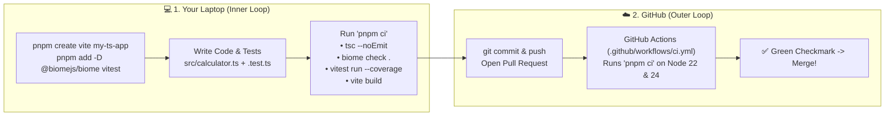

# Chapter 15: Putting It All Together

[← Previous: LLMs and AI-Powered Development](./14-llms.md) | [Back to README](./README.md) | [Next: Using This Setup for JavaScript Projects →](./16-javascript.md)

---

You've met all the individual tools across this guide. When you open a mature TypeScript repository on GitHub, it is easy to feel overwhelmed by a dozen configuration files in the root folder.

**Here is the good news: a clean, production-ready TypeScript project only needs four core pieces:**

1. **Dependencies & Scripts:** `package.json` + `pnpm-lock.yaml` ([Chapters 2](./02-node-environments.md) & [3](./03-package-management.md))
2. **Strict Type Checking:** `tsconfig.json` ([Chapter 1](./01-introduction.md))
3. **Fast Linting, Formatting & Unit Tests:** `biome.json` + `vitest.config.ts` ([Chapters 5](./05-linting.md)–[7](./07-testing.md))
4. **Automated Cloud Verification:** `.github/workflows/ci.yml` ([Chapter 13](./13-ci-cd.md))

Everything else (`.mise.toml` runtime pinning, `AGENTS.md`, `specs/`, and one-prompt AI scaffolding) is an optional power-up that you can layer on when working with a team or AI coding agents. Let's build the core project first so you understand every file, and then look at the optional add-ons.



---

## Part 1: The Essential 5-Minute TypeScript Setup (Zero Bloat)

Here is the clean directory layout we are building:

```text
my-ts-app/
├── .github/
│   └── workflows/
│       └── ci.yml            # 4. Automated GitHub Actions check
├── src/
│   ├── calculator.ts         # Your strictly typed code
│   ├── calculator.test.ts    # Your Vitest unit tests
│   └── main.ts
├── .gitignore
├── biome.json                # 3a. Linter + formatter config (Biome)
├── package.json              # 1. Dependencies & scripts
├── pnpm-lock.yaml            # Auto-generated lockfile (commit this!)
├── tsconfig.json             # 2. Strict TypeScript compiler config
└── vitest.config.ts          # 3b. Test & coverage config
```

### Step 1: Scaffold with Vite & Install Biome + Vitest

Make sure you are on **Node.js 22 or 24 LTS** and **pnpm 10** ([Chapter 2](./02-node-environments.md)), then scaffold a `vanilla-ts` project:

```bash
pnpm create vite my-ts-app -- --template vanilla-ts
cd my-ts-app

# Install Biome (lint + format) and Vitest (unit tests + coverage)
pnpm add -D @biomejs/biome vitest @vitest/coverage-v8

# Generate a starter biome.json
pnpm biome init
```

### Step 2: Lock Down `tsconfig.json`

Replace the starter `tsconfig.json` with a strict configuration that catches `undefined` array indexing and implicit returns at compile time:

```json
{
  "compilerOptions": {
    "target": "ES2022",
    "module": "ESNext",
    "moduleResolution": "Bundler",
    "strict": true,
    "noUncheckedIndexedAccess": true,
    "exactOptionalPropertyTypes": true,
    "noImplicitReturns": true,
    "noFallthroughCasesInSwitch": true,
    "skipLibCheck": true,
    "noEmit": true
  },
  "include": ["src/**/*"],
  "exclude": ["node_modules", "dist"]
}
```

### Step 3: Configure Vitest (`vitest.config.ts`)

Create `vitest.config.ts` to run tests and enforce an 80% line-coverage floor:

```typescript
import { defineConfig } from 'vitest/config';

export default defineConfig({
  test: {
    globals: true,
    environment: 'node',
    coverage: {
      provider: 'v8',
      reporter: ['text', 'html'],
      include: ['src/**/*.ts'],
      exclude: ['src/main.ts', 'src/**/*.test.ts'],
      thresholds: { lines: 80 },
    },
  },
});
```

### Step 4: Clean `package.json` Scripts & `.gitignore`

Because Biome handles *both* linting and formatting in a single pass (`biome check`), you don't need a dozen overlapping scripts in `package.json`. Keep your `"scripts"` block focused:

```json
{
  "scripts": {
    "dev": "vite",
    "build": "tsc --noEmit && vite build",
    "typecheck": "tsc --noEmit",
    "check": "biome check .",
    "check:write": "biome check --write .",
    "test": "vitest",
    "test:coverage": "vitest run --coverage",
    "ci": "pnpm typecheck && pnpm check && pnpm test:coverage && pnpm build"
  }
}
```

Make sure `.gitignore` keeps build artifacts, coverage reports, and `.env` secrets out of Git:

```gitignore
node_modules/
dist/
coverage/
.env
.env.*.local
.DS_Store
*.tsbuildinfo
```

### Step 5: Write Code, Write Tests & Run `pnpm ci`

Create **`src/calculator.ts`**:

```typescript
export function add(a: number, b: number): number {
  return a + b;
}

export function divide(a: number, b: number): number {
  if (b === 0) throw new Error('Cannot divide by zero');
  return a / b;
}

export function calculatePercentage(part: number, whole: number): number {
  if (whole === 0) throw new Error('Whole cannot be zero');
  return Math.round((part / whole) * 10000) / 100;
}
```

Create **`src/calculator.test.ts`**:

```typescript
import { describe, expect, it } from 'vitest';
import { add, calculatePercentage, divide } from './calculator';

describe('calculator', () => {
  it('adds numbers', () => expect(add(2, 3)).toBe(5));
  it('divides numbers', () => expect(divide(10, 2)).toBe(5));
  it('throws on divide by zero', () => {
    expect(() => divide(1, 0)).toThrow('Cannot divide by zero');
  });
  it('calculates percentage rounded to 2 decimal places', () => {
    expect(calculatePercentage(1, 3)).toBe(33.33);
    expect(() => calculatePercentage(5, 0)).toThrow('Whole cannot be zero');
  });
});
```

Auto-format your files and run the full quality gate with one command:

```bash
pnpm check:write
pnpm ci
```

### Step 6: Add GitHub Actions CI & Push to GitHub

Create **`.github/workflows/ci.yml`** so GitHub runs `pnpm ci` automatically on every push and Pull Request:

```yaml
name: CI

on:
  push:
    branches: [main]
  pull_request:
    branches: [main]

jobs:
  quality:
    runs-on: ubuntu-latest
    strategy:
      matrix:
        node-version: [22.x, 24.x]
    steps:
      - uses: actions/checkout@v4
      - uses: pnpm/action-setup@v4
        with:
          version: 10
      - uses: actions/setup-node@v4
        with:
          node-version: ${{ matrix.node-version }}
          cache: 'pnpm'
      - run: pnpm install --frozen-lockfile
      - run: pnpm ci
```

Now commit and push to GitHub:

```bash
git init && git add .
git commit -m "Initial TypeScript setup with Vite, Biome, Vitest, and CI"
git branch -M main
# Create a new repo at github.com/new (or run `gh repo create my-ts-app --public --source=. --push`):
git remote add origin https://github.com/<your-username>/my-ts-app.git
git push -u origin main
```

---

## Part 2: Optional Power-Ups for Teams & AI Coding Agents

You don't need the extras below for a quick solo script, but they pay off immediately when working with teammates or AI coding agents ([Chapter 14](./14-llms.md)).

### 1. Pin Node & pnpm Automatically with `mise` (`.mise.toml`)

If teammates use [mise](https://mise.jdx.dev) ([Chapter 2](./02-node-environments.md)), adding a 3-line `.mise.toml` in your repo root ensures everyone runs the exact same Node and pnpm versions automatically:

```toml
[tools]
node = "24"
pnpm = "10"
```

### 2. Add `AGENTS.md` for AI Coding Assistants

Coding agents (Claude Code, Cursor, GitHub Copilot, `agy`, Codex) read **`AGENTS.md`** (or `CLAUDE.md`) in your repo root at the start of every session so they know your stack and commands without guessing:

```markdown
# AGENTS.md

## Stack & Commands
- Runtime & packages: Node.js 24 LTS + pnpm 10 (`pnpm install`)
- Format & fix lints: `pnpm check:write`
- Full verification gate: `pnpm ci` (runs `tsc --noEmit`, `biome check`, `vitest --coverage`, and `vite build`)

## Rules
- Never use `any`, `@ts-ignore`, or `biome-ignore` to silence errors.
- Add or update Vitest tests (`src/**/*.test.ts`) for every behavior change.
- Run `pnpm ci` and confirm it exits 0 before finishing any task.
```

### 3. Layer In Specs & Agent Skills as Your Repo Grows

When building larger features or web UIs with AI agents, combine `AGENTS.md` with these open-source references:

- **Spec-Driven Development (`specs/` or [OpenSpec](https://openspec.dev/)):** Draft a short Markdown spec (`specs/feature.spec.md` or `/opsx:propose` with [`Fission-AI/OpenSpec`](https://github.com/Fission-AI/OpenSpec)) defining types, edge cases, and acceptance criteria before coding. See also **[GitHub Spec Kit (`spec-kit`)](https://github.com/github/spec-kit)** for greenfield project specs and **[EGM](https://egm.dev/)** for cold adversarial spec reviews.
- **[Addy Osmani's `agent-skills`](https://github.com/addyosmani/agent-skills) ([agenticskills.io](https://agenticskills.io/)):** Portable `SKILL.md` workflows (`/spec`, `/plan`, `/build`, `/test`, `/review`) that complement OpenSpec, Spec Kit, and EGM by teaching your agent senior-engineer habits for test-driven implementation, code simplification, and security review.
- **[Google Chrome's Modern Web Guidance](https://github.com/googlechrome/modern-web-guidance):** An open-source reference and agent skill that steers humans and LLMs toward modern Baseline browser APIs (`<dialog>`, Popover API, CSS container queries, Core Web Vitals) instead of legacy workarounds.

---

## Part 3: Fast-Forward Scaffolding (One AI Prompt or Template)

Once you understand the core files in Part 1, you can spin up future repositories in 30 seconds.

### Option A: One-Prompt AI Bootstrap

Open an empty folder in **Claude Code**, **Cursor**, **GitHub Copilot**, or **`agy`** and paste:

```text
Scaffold a strict TypeScript project in the current directory using pnpm and Vite:
1. Run `pnpm create vite . -- --template vanilla-ts` and `pnpm add -D @biomejs/biome vitest @vitest/coverage-v8`, then `pnpm biome init`.
2. Configure `tsconfig.json` with `strict: true`, `noUncheckedIndexedAccess: true`, `exactOptionalPropertyTypes: true`, `noImplicitReturns: true`, and `noEmit: true`.
3. Configure `vitest.config.ts` with V8 coverage (`thresholds: { lines: 80 }`).
4. Add `package.json` scripts: `typecheck` (`tsc --noEmit`), `check` (`biome check .`), `check:write` (`biome check --write .`), `test:coverage` (`vitest run --coverage`), and `ci` (`pnpm typecheck && pnpm check && pnpm test:coverage && pnpm build`).
5. Create `.github/workflows/ci.yml` running `pnpm install --frozen-lockfile && pnpm ci` on Node 22.x and 24.x, plus a concise `AGENTS.md`.
6. Create `src/calculator.ts` and `src/calculator.test.ts`, then run `pnpm check:write && pnpm ci` until all checks pass.
```

### Option B: Project Templates & Git Hooks

- Turn your finished repo into a **GitHub Template Repository** (Settings → *Template repository*) or use [cookiecutter-typescript-library](https://github.com/amitsk/cookiecutter-typescript-library).
- Want `pnpm check` to run automatically on every `git commit`? Add [lefthook](https://github.com/evilmartians/lefthook) or [Husky](https://typicode.github.io/husky/).

---

## What's Next?

Next, [Chapter 16](./16-javascript.md) shows how to use this exact same toolchain for plain JavaScript projects with JSDoc, and [Chapter 17](./17-aws-lambda.md) takes TypeScript serverless with AWS Lambda.

[← Previous: LLMs and AI-Powered Development](./14-llms.md) | [Back to README](./README.md) | [Next: Using This Setup for JavaScript Projects →](./16-javascript.md)
