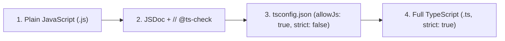

# Chapter 16: Using This Setup for JavaScript Projects

[← Previous: Putting It All Together](./15-putting-it-together.md) | [Back to README](./README.md) | [Next: AWS Lambda with TypeScript →](./17-aws-lambda.md)

---

Plot twist: almost none of the tools in this guide are TypeScript-only! Vite, Vitest, Biome, ESLint, Fastify, Drizzle, and GitHub Actions work identically with plain `.js` files. Learning this setup makes you productive in both JavaScript and TypeScript.

---

## Starting a Plain JavaScript Project

Use the `vanilla` Vite template (without `-ts`) and drop `tsc --noEmit` from your scripts:

```bash
pnpm create vite my-js-app -- --template vanilla
```

```json
{
  "scripts": {
    "dev": "vite",
    "build": "vite build",
    "test": "vitest",
    "check": "biome check --write ."
  }
}
```

Vitest (`.test.js`), Biome (`biome check`), Fastify, and Prisma/Drizzle all work the exact same way — you just skip writing `: string` and `interface` annotations.

---

## The Secret Middle Ground: JSDoc + `// @ts-check`

Want type checking in a `.js` file without setting up a build step? Put `// @ts-check` at the top of any JavaScript file and add JSDoc comments. VSCode's built-in TypeScript engine will type-check your plain JavaScript in real time:

```javascript
// @ts-check

/**
 * @param {number} a
 * @param {number} b
 * @returns {number}
 */
export function add(a, b) {
  return a + b;
}

add("hello", 2); // VSCode underlines "hello" in red immediately!
```

---

## Recommendations: JS vs. TS & Incremental Migration

- **Use Plain JavaScript (with `// @ts-check`)** for tiny 50-line automation scripts, throwaway hackathon prototypes, or build scripts where a compile step is overkill.
- **Use TypeScript** for any project that has teammates, database models, API contracts, or code you still plan to maintain next month.
- **Migrating an existing JS project?** Don't rewrite the whole app over a weekend. Turn on `"allowJs": true` and `"checkJs": true` in `tsconfig.json`, and convert one file at a time from `.js` to `.ts`:



---

## Official Documentation Bookmarks

Keep these handy as you build:

- **Runtimes & Packages**: [Node.js](https://nodejs.org) · [Volta](https://volta.sh) · [mise](https://mise.jdx.dev) · [nvm](https://github.com/nvm-sh/nvm) · [pnpm](https://pnpm.io)
- **Language & Quality**: [TypeScript](https://www.typescriptlang.org/docs/) · [Biome](https://biomejs.dev) · [ESLint](https://eslint.org) · [Prettier](https://prettier.io) · [Oxc (Oxlint / oxfmt)](https://oxc.rs)
- **Testing, Build & Web**: [Vitest](https://vitest.dev) · [Vite](https://vite.dev) · [Modern Web Guidance](https://github.com/googlechrome/modern-web-guidance)
- **Backend, Full-Stack & Data**: [Fastify](https://fastify.dev) · [TanStack Start](https://tanstack.com/start) · [Drizzle](https://orm.drizzle.team) · [Prisma](https://www.prisma.io/docs) · [Kysely](https://kysely.dev) · [Pino](https://getpino.io)
- **AI Agents & Spec-Driven Dev**: [Cursor](https://cursor.com) · [Claude Code](https://github.com/anthropics/claude-code) · [Google Antigravity (`agy`)](https://antigravity.google/docs) · [Grok Build](https://github.com/xai-org/grok-build) · [GitHub Copilot CLI](https://github.com/github/copilot-cli) · [OpenAI Codex CLI](https://github.com/openai/codex) · [OpenSpec](https://openspec.dev/) · [Spec Kit](https://github.com/github/spec-kit) · [Addy Osmani's `agent-skills`](https://github.com/addyosmani/agent-skills) · [EGM](https://egm.dev/)

---

## What's Next?

Our final chapter applies this toolchain to serverless cloud functions in [Chapter 17: AWS Lambda with TypeScript](./17-aws-lambda.md).

[← Previous: Putting It All Together](./15-putting-it-together.md) | [Back to README](./README.md) | [Next: AWS Lambda with TypeScript →](./17-aws-lambda.md)
