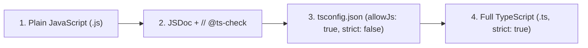

# Chapter 16: Using This Setup for JavaScript Projects

[← Previous: Putting It All Together](./15-putting-it-together.md) | [Back to README](./README.md) | [Next: AWS Lambda with TypeScript →](./17-aws-lambda.md)

---

Everything in this guide has been framed around TypeScript, but here is something important to know: almost none of the tools we covered are TypeScript-only. Vite, Vitest, Biome, ESLint, Fastify, Drizzle, and GitHub Actions all work perfectly with plain JavaScript. TypeScript is opt-in — you choose how much (or how little) typing to add.

This chapter shows you how to use the same development environment for JavaScript projects, covers JSDoc as a middle ground between untyped JS and full TypeScript, and gives you a clear guide for when to use each approach.

---

## Everything Works for JavaScript Too

The tools in this guide support both languages without configuration changes in most cases:

- **Vite** — bundles `.js` files just as well as `.ts` files. You just skip the TypeScript template.
- **Vitest** — `.test.js` files work exactly like `.test.ts` files. Same API, same runner.
- **Biome** — handles both JS and TS. No config change needed.
- **ESLint** — works with JS by default. TypeScript support is an add-on.
- **Fastify** — a Node.js HTTP framework. TypeScript types are optional.
- **Drizzle** — can write schemas in `.js` files and generates JavaScript output.
- **GitHub Actions** — runs shell commands. It does not care whether your project is JS or TS.

The investment you make in learning this toolchain pays off regardless of which language you choose.

---

## Starting a Plain JavaScript Project with Vite

Creating a JavaScript project with Vite is identical to creating a TypeScript project — just use a different template:

```bash
pnpm create vite my-js-app -- --template vanilla
cd my-js-app
pnpm install
pnpm dev
```

The `vanilla` template (without `-ts`) generates `.js` files. The project structure looks the same, but without `tsconfig.json` and without `.ts` extensions.

The differences from the TypeScript setup are minimal:

- Files use `.js` extensions instead of `.ts`
- No `tsconfig.json` needed
- No `tsc --noEmit` step in the build
- The `build` script is just `vite build` instead of `tsc --noEmit && vite build`

Everything else — the dev server, hot module replacement, bundling, imports — works identically.

---

## package.json for a JavaScript Project

Here is what a clean JavaScript project's `package.json` scripts section looks like. Compare it to the TypeScript version from [Chapter 15](./15-putting-it-together.md) — the only differences are the removal of `typescript` from devDependencies and the removal of `tsc --noEmit` from the build and CI scripts:

```json
{
  "scripts": {
    "dev": "vite",
    "build": "vite build",
    "test": "vitest",
    "lint": "biome lint .",
    "format": "biome format --write .",
    "check": "biome check --write ."
  }
}
```

No `typecheck` script, no `tsc` in the build pipeline. The `devDependencies` section does not need `typescript` either. Everything else — Vitest, Biome, Vite — installs and runs exactly the same way.

---

## Vitest Works the Same for JavaScript

One of the best things about Vitest is that there is truly no difference between testing JavaScript and TypeScript. Write your test files with a `.test.js` extension and the same API is available:

```javascript
import { describe, it, expect } from 'vitest';
import { add, divide } from './calculator.js';

describe('calculator', () => {
  it('adds numbers', () => expect(add(2, 3)).toBe(5));
  it('divides numbers', () => expect(divide(10, 2)).toBe(5));
  it('throws on divide by zero', () => {
    expect(() => divide(1, 0)).toThrow('Cannot divide by zero');
  });
});
```

The `vitest.config.js` (or `.ts` — Vitest can read either) uses the same `defineConfig` call. No changes to the `coverage`, `globals`, or `environment` settings are needed.

---

## Biome Works the Same for JavaScript

Biome was designed from the start to handle both languages. A single `biome.json` covers all your `.js` and `.ts` files without any special configuration.

```bash
pnpm biome check --write .
```

That command lints and formats every JavaScript and TypeScript file in your project.

If you are using ESLint instead of Biome, the change for a JavaScript project is straightforward: remove the `typescript-eslint` plugin from your ESLint config and remove any rules that require type information (rules prefixed with `@typescript-eslint/`). The base ESLint rules and any other plugins (like `eslint-plugin-import`) continue to work unchanged.

---

## Fastify Works with JavaScript

In Chapter 9, we showed Fastify routes with TypeScript type annotations. In JavaScript, you simply remove those annotations. The framework behaves identically — you just lose the compile-time type checking on the request and reply objects.

TypeScript version:

```typescript
import Fastify from 'fastify';

const app = Fastify({ logger: true });

interface CreateUserBody {
  name: string;
  email: string;
}

app.post<{ Body: CreateUserBody }>('/users', async (request, reply) => {
  const { name, email } = request.body;
  return reply.status(201).send({ id: 1, name, email });
});

await app.listen({ port: 3000 });
```

JavaScript version — same structure, no type annotations:

```javascript
import Fastify from 'fastify';

const app = Fastify({ logger: true });

app.post('/users', async (request, reply) => {
  const { name, email } = request.body;
  return reply.status(201).send({ id: 1, name, email });
});

await app.listen({ port: 3000 });
```

The route handler still works. You still get Fastify's built-in JSON serialization, error handling, and plugin system. You just do not get a compile-time error if you accidentally access a property that does not exist on `request.body`.

---

## Drizzle and Prisma Work with JavaScript

Both of the database libraries covered in Chapter 11 generate JavaScript output by default.

**Prisma** generates a JavaScript client in `node_modules/@prisma/client`. You can import and use it in `.js` files without any changes:

```javascript
import { PrismaClient } from '@prisma/client';

const prisma = new PrismaClient();

const users = await prisma.user.findMany();
```

The Prisma CLI and schema file are language-agnostic — they generate the same client whether your project uses JavaScript or TypeScript.

**Drizzle** allows you to write your schema in `.js` files:

```javascript
import { pgTable, serial, text, varchar } from 'drizzle-orm/pg-core';

export const users = pgTable('users', {
  id: serial('id').primaryKey(),
  name: text('name').notNull(),
  email: varchar('email', { length: 256 }).notNull(),
});
```

You lose some of the deep type inference that makes Drizzle especially powerful in TypeScript, but the queries still work and the migration tooling operates identically.

---

## JSDoc — Typed JavaScript Without TypeScript

There is a middle ground between fully untyped JavaScript and full TypeScript: **JSDoc**. JSDoc is a comment syntax for adding type annotations directly in `.js` files. VSCode (and other editors) read these annotations and provide the same type checking and autocomplete you would get from TypeScript — without any compilation step.

Here is what JSDoc type annotations look like:

```javascript
/**
 * @param {number} a - First number
 * @param {number} b - Second number
 * @returns {number} The sum
 */
function add(a, b) {
  return a + b;
}

/** @type {import('./types').User} */
const user = { id: 1, name: 'Alice' };
```

The `@param`, `@returns`, and `@type` tags tell your editor what types to expect. VSCode will underline type mismatches and offer autocompletion based on these annotations, just as it would for a `.ts` file.

### `@ts-check` for file-level type checking

Add this comment to the top of any `.js` file to enable TypeScript-level error checking without converting the file to `.ts`:

```javascript
// @ts-check

/**
 * @param {string} name
 * @returns {string}
 */
function greet(name) {
  return `Hello, ${name}!`;
}

// TypeScript will catch this error even in a .js file:
greet(42); // Argument of type 'number' is not assignable to parameter of type 'string'
```

No build step, no `tsconfig.json`, no `.ts` extension required. You get real type errors highlighted in your editor.

### When to use JSDoc

JSDoc is a great middle ground for:

- Projects where you want some type safety but are not ready for the full TypeScript setup
- Adding type hints to existing JavaScript without a migration
- Scripts and utilities where a compilation step would be inconvenient
- Teaching TypeScript concepts — JSDoc makes the types visible without changing the file format

---

## When to Choose JavaScript Over TypeScript

TypeScript is not always the right choice. Here are the situations where plain JavaScript makes more sense:

**Small scripts and automation**

A 50-line Node.js script that runs a database migration or renames some files does not benefit much from TypeScript. The setup cost is not worth it.

**Quick prototypes**

When you are exploring an idea and the code will likely be thrown away, the extra verbosity of TypeScript can slow you down. Start in JavaScript; add TypeScript if the prototype turns into something real.

**Teams not yet familiar with TypeScript**

Introducing TypeScript to a team that has never used it adds cognitive load at a time when you might need to move fast. Start with JavaScript and adopt TypeScript incrementally as the team gets comfortable.

**Environments where compilation adds complexity**

Some deployment environments or build pipelines make it difficult to add a compilation step. JavaScript avoids that friction.

---

## When to Migrate from JavaScript to TypeScript

Several signals indicate it is time to switch:

**Your codebase is growing and bugs are harder to track down**

When a codebase grows beyond a few thousand lines, the number of ways things can go wrong grows faster than your ability to remember them. TypeScript's type checker acts as a second pair of eyes that never sleeps.

**You want better IDE support and refactoring confidence**

Renaming a function or changing its signature becomes risky in a large JavaScript codebase — you have to manually find every call site. TypeScript's language server can find them all instantly and flag the ones you missed.

**New team members are joining and documentation is lacking**

Types serve as machine-readable documentation. A new developer reading `function createUser(data: CreateUserInput): Promise<User>` immediately knows what the function expects and returns, without reading the implementation.

### Incremental migration with `allowJs`

You never have to migrate everything at once. TypeScript supports a gradual migration path using `allowJs` and `checkJs`:

```json
{
  "compilerOptions": {
    "allowJs": true,
    "checkJs": true,
    "strict": false
  }
}
```

With these settings:

- `allowJs: true` — TypeScript will accept `.js` files alongside `.ts` files
- `checkJs: true` — TypeScript will type-check your `.js` files using inference and any JSDoc annotations you have added
- `strict: false` — starts with lenient checking so you are not overwhelmed by errors on day one

From here, you can rename files from `.js` to `.ts` one at a time, adding types as you go. Tighten the compiler options (turn on `strict: true`, then individual strict flags) as the codebase improves. A large JavaScript project can be fully migrated to TypeScript over weeks or months without ever breaking the build.



---

## The Shared Ecosystem Is the Key Point

Here is a comparison of a JavaScript project and a TypeScript project side by side:

| Tool | JavaScript Project | TypeScript Project |
|---|---|---|
| Vite | `--template vanilla` | `--template vanilla-ts` |
| Vitest | `.test.js` files | `.test.ts` files |
| Biome | Same config | Same config |
| ESLint | Base rules | + `typescript-eslint` plugin |
| Fastify | No type params | Generic type params |
| Drizzle | `.js` schema | `.ts` schema, richer types |
| GitHub Actions | No `typecheck` step | Adds `typecheck` step |

The only meaningful differences are the presence or absence of type annotations and the TypeScript compilation step. Every other tool, every workflow pattern, every CI setup — identical.

This means the time you invest in learning this toolchain is not wasted if you decide to start with JavaScript. You are not learning "a TypeScript toolchain" — you are learning a modern JavaScript ecosystem that TypeScript happens to work exceptionally well in.

---

## Chapter Recap (so far)

You have now covered the shared JS/TS toolchain and when to stay in plain JavaScript. Here is an accurate map of the guide:

1. **Introduction** — What this guide is (tooling, not a language course) and the ecosystem overview
2. **Node.js Environments** — LTS, nvm / Volta / mise, optional Bun/Deno note
3. **Package Management** — package.json, npm vs pnpm, Yarn note, Corepack, lock files
4. **Version Control** — Git, `.gitignore`, GitHub, branching
5. **Linting** — ESLint, Oxlint, Biome
6. **Code Formatting** — Prettier, Biome, oxfmt (beta)
7. **Unit Testing with Vitest** — Setup, assertions, coverage
8. **Building with Vite** — Dev server, HMR, production builds, typecheck split
9. **REST APIs with Fastify** — Typed routes, TypeBox, plugins
10. **Full-Stack with TanStack Start** — Server functions and type-safe routing
11. **Database Libraries** — Drizzle, Prisma, Kysely, DynamoDB
12. **Logging** — console vs Winston vs Pino
13. **CI/CD** — GitHub Actions for TypeScript projects
14. **LLMs and AI-Powered Development** — Cursor, Claude Code, `agy`, Grok Build, Copilot CLI, Codex, Spec-Driven Development (EGM, OpenSpec), Zod pointer
15. **Putting It All Together** — End-to-end project setup
16. **JavaScript Projects** (this chapter) — JSDoc, migration, same toolchain without TS
17. **AWS Lambda** (next) — Serverless TypeScript, SAM, Oxlint/Biome

### Suggested adoption order

Start simple. You do not need every tool on day one:

1. Install a Node version manager (Volta recommended) and pnpm
2. Add TypeScript — or JSDoc if you prefer to stay in JavaScript
3. Add Vitest — tests pay dividends immediately
4. Add Biome — formatting and linting with almost no setup
5. Add GitHub Actions CI — once you have tests, CI is a YAML file away

### Official documentation

- **Volta**: https://volta.sh
- **pnpm**: https://pnpm.io
- **TypeScript**: https://www.typescriptlang.org/docs/
- **Biome**: https://biomejs.dev
- **ESLint**: https://eslint.org
- **Prettier**: https://prettier.io
- **Oxc (Oxlint / oxfmt)**: https://oxc.rs
- **Vitest**: https://vitest.dev
- **Vite**: https://vite.dev
- **Fastify**: https://fastify.dev
- **TanStack Start**: https://tanstack.com/start
- **Drizzle**: https://orm.drizzle.team
- **Prisma**: https://www.prisma.io/docs
- **GitHub Actions**: https://docs.github.com/en/actions
- **Cursor**: https://cursor.com
- **Claude Code**: https://github.com/anthropics/claude-code
- **Google Antigravity (`agy`)**: https://antigravity.google/docs
- **Grok Build**: https://github.com/xai-org/grok-build
- **GitHub Copilot & Copilot CLI**: https://github.com/features/copilot / https://github.com/github/copilot-cli
- **OpenAI Codex CLI**: https://github.com/openai/codex
- **Elephant-Goldfish Model (EGM)**: https://egm.dev/
- **OpenSpec**: https://openspec.dev/

## What's Next?

The last chapter applies this toolchain to **serverless**: AWS Lambda handlers in TypeScript, local testing with SAM, DynamoDB, and a fast Oxlint + Biome workflow.

[← Previous: Putting It All Together](./15-putting-it-together.md) | [Back to README](./README.md) | [Next: AWS Lambda with TypeScript →](./17-aws-lambda.md)
