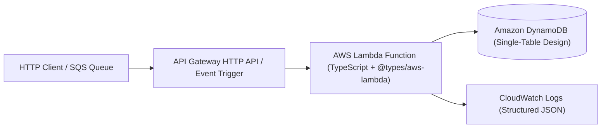

# Chapter 17: AWS Lambda with TypeScript

[← Previous: Using This Setup for JavaScript Projects](./16-javascript.md) | [Back to README](./README.md)

---

Why pay for a server 24/7 when your side project only gets traffic when you show it to your friends? **AWS Lambda** is serverless computing: you upload a TypeScript function, AWS runs it only when an event arrives (an HTTP request, an SQS queue message, an S3 file upload), scales it automatically from zero to thousands of instances, and charges you fractions of a cent per invocation.

TypeScript shines on Lambda because deploying to the cloud to discover you typed `event.body.usreId` instead of `userId` is painful. The `@types/aws-lambda` package gives you compile-time autocomplete for every AWS event payload.



---

## Project Setup

Install the [AWS CLI](https://docs.aws.amazon.com/cli/latest/userguide/install-cliv2.html) and [AWS SAM CLI](https://docs.aws.amazon.com/serverless-application-model/latest/developerguide/install-sam-cli.html) (`brew install awscli aws-sam-cli` on macOS), then initialize your project:

```bash
mkdir my-lambda-app && cd my-lambda-app
pnpm init
pnpm add @aws-sdk/client-dynamodb @aws-sdk/lib-dynamodb
pnpm add -D typescript @types/node @types/aws-lambda esbuild oxlint @biomejs/biome vitest
```

---

## Spec First, Then Code

Serverless bugs are expensive: you cannot SSH into a Lambda to poke around, and a wrong DynamoDB key or missing IAM permission may only fail in the cloud. Use the **Spec-Driven Development (SDD)** workflow from [Chapter 14](./14-llms.md) — and the bootstrap spec pattern from [Chapter 15](./15-putting-it-together.md) — before writing handlers. A useful Lambda spec covers:

- **Trigger & contract:** API Gateway HTTP API event, request body/query/path schema, status codes, and error shape.
- **Typed inputs/outputs:** `APIGatewayProxyEventV2`, `APIGatewayProxyResultV2`, `SQSEvent`, and friends from `@types/aws-lambda`.
- **Data & access patterns:** DynamoDB table, `PK`/`SK` layout, indexes, and required IAM permissions.
- **Retries & idempotency:** what happens when the same event is delivered twice.
- **Limits:** timeout, memory, payload size, and concurrency.
- **Verification:** `pnpm typecheck`, Vitest handler tests, `sam local start-api` smoke test, and `sam deploy` to a sandbox stack.

````markdown
# Spec 001: Create User Endpoint

## Goal
Handle `POST /users` and return the created user.

## Rules & Edge Cases
- Missing `name` or `email` returns `400` with `{ "error": "..." }`.
- Valid input returns `201` with `{ id: <uuid>, name, email }`.
- Duplicate emails return `409` (or explicitly mark deduplication out of scope).
- Handler must finish well under the configured 30-second timeout.

## Verification
- [ ] `pnpm typecheck` passes
- [ ] Vitest tests cover `201`, `400`, and `409`
- [ ] `sam local start-api` returns the expected responses
````

Then implement against the spec plus an `AGENTS.md` file ([Chapter 15](./15-putting-it-together.md)), and optionally run the EGM Goldfish review from [Chapter 14](./14-llms.md) so a stateless agent flags missing edge cases before you deploy.

---

## Writing a Typed Lambda Handler

Create `src/handlers/create-user.ts`. Using `APIGatewayProxyEventV2` and `APIGatewayProxyResultV2` guarantees your request and response shapes match API Gateway HTTP APIs:

```typescript
import type { APIGatewayProxyEventV2, APIGatewayProxyResultV2, Context } from 'aws-lambda';

interface CreateUserBody {
  name: string;
  email: string;
}

export const handler = async (
  event: APIGatewayProxyEventV2,
  _context: Context,
): Promise<APIGatewayProxyResultV2> => {
  if (!event.body) {
    return { statusCode: 400, body: JSON.stringify({ error: 'Request body is required' }) };
  }

  const body = JSON.parse(event.body) as Partial<CreateUserBody>;
  if (!body.name || !body.email) {
    return { statusCode: 400, body: JSON.stringify({ error: 'name and email are required' }) };
  }

  const user = { id: crypto.randomUUID(), name: body.name, email: body.email };
  return {
    statusCode: 201,
    headers: { 'Content-Type': 'application/json' },
    body: JSON.stringify(user),
  };
};
```

*(Need other triggers? `@types/aws-lambda` also exports `SQSEvent`, `S3Event`, `SNSEvent`, `DynamoDBStreamEvent`, and `EventBridgeEvent`.)*

---

## Infrastructure as Code with AWS SAM (`template.yaml`)

**AWS SAM** lets you define your Lambda functions, API routes, and DynamoDB table in one `template.yaml` file, and bundles TypeScript automatically using `esbuild`:

```yaml
AWSTemplateFormatVersion: '2010-09-09'
Transform: AWS::Serverless-2016-10-31
Description: TypeScript Lambda Service

Globals:
  Function:
    Runtime: nodejs22.x
    Architectures: [arm64]
    Timeout: 30
    MemorySize: 256

Resources:
  CreateUserFunction:
    Type: AWS::Serverless::Function
    Properties:
      Handler: create-user.handler
      Events:
        CreateUser:
          Type: HttpApi
          Properties:
            Path: /users
            Method: POST
    Metadata:
      BuildMethod: esbuild
      BuildProperties:
        EntryPoints:
          - src/handlers/create-user.ts
        Bundle: true
        Target: es2022
```

### Build, Test Locally & Deploy

```bash
sam build                        # Bundles TypeScript via esbuild
sam local start-api              # Starts local API Gateway on http://localhost:3000 (uses Docker)
sam deploy --guided              # Deploys stack to AWS
```

---

## Fast Linting, Formatting & Unit Testing

In Chapter 15 we used Biome for everything. Here's another popular high-speed combo for serverless projects: **Oxlint** for linting + **Biome** (or **oxfmt** beta) for formatting, and **Vitest** for unit testing handlers without needing Docker or AWS credentials:

```typescript
// src/handlers/create-user.test.ts
import { describe, it, expect } from 'vitest';
import type { APIGatewayProxyEventV2, Context } from 'aws-lambda';
import { handler } from './create-user';

describe('createUser handler', () => {
  it('returns 201 for valid payload', async () => {
    const event = { body: JSON.stringify({ name: 'Alice', email: 'a@b.com' }) } as APIGatewayProxyEventV2;
    const res = await handler(event, {} as Context);
    expect(res).toMatchObject({ statusCode: 201 });
  });

  it('returns 400 when body is missing', async () => {
    const res = await handler({} as APIGatewayProxyEventV2, {} as Context);
    expect(res).toMatchObject({ statusCode: 400 });
  });
});
```

Complete `package.json` scripts:

```json
{
  "scripts": {
    "build": "sam build",
    "typecheck": "tsc --noEmit",
    "lint": "oxlint src/",
    "format": "biome format --write src/",
    "format:check": "biome format src/",
    "test:run": "vitest run",
    "local": "sam local start-api",
    "deploy": "sam deploy"
  }
}
```

---

## Recommendations: When to Choose Lambda + DynamoDB vs. Fastify + Postgres

- **Choose AWS Lambda + DynamoDB** for event-driven pipelines (SQS queues, S3 uploads, webhooks), bursty or unpredictable traffic, and side projects where scale-to-zero means a $0.00 monthly AWS bill.
- **Choose Fastify + PostgreSQL (Drizzle/Prisma)** for steady-traffic APIs, apps requiring complex relational SQL joins, or teams that want portable Docker deployments across any cloud provider.

---

## Conclusion — You Made It!

You now have a complete, professional TypeScript setup in your toolkit: Node LTS management, pnpm, Git workflows, linting, formatting, Vitest, Vite, Fastify, TanStack Start, type-safe databases, structured logging, GitHub Actions CI/CD, Spec-Driven AI development, and serverless AWS Lambda.

Pick a project idea, write a quick spec, run `pnpm create vite`, and go build something awesome!

[← Previous: Using This Setup for JavaScript Projects](./16-javascript.md) | [Back to README](./README.md)
