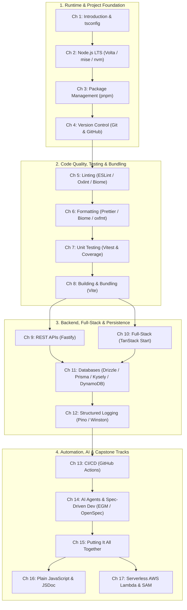

# TypeScript Development Environment Setup Guide

This guide is for developers who want to set up a professional, modern TypeScript development environment from scratch. Whether you're a student who has written some code before, a JavaScript developer moving into TypeScript, or someone who wants to level up your tooling knowledge, this guide walks you through everything you need — version control, linting, formatting, testing, building, and deploying TypeScript projects.

## About This Guide

This is **not** a TypeScript or JavaScript language tutorial. It assumes you either already know some TypeScript/JavaScript, or that you'll be learning the language alongside setting up your environment.

If you need to learn the language itself, these are excellent resources:

- [TypeScript Handbook](https://www.typescriptlang.org/docs/) — the official TypeScript documentation
- [MDN JavaScript Guide](https://developer.mozilla.org/en-US/docs/Web/JavaScript/Guide) — Mozilla's comprehensive JavaScript reference

What this guide **is**: a practical walkthrough of the professional tools, workflows, and practices used by TypeScript developers in the real world. By the end, you'll have a complete development environment and understand why each tool exists.

> **Currency note (2026):** Examples target **Node.js 22/24 LTS**, pnpm 10, and current tooling docs. Node 20 is end of life — do not start new projects on it. Always re-check official release pages for tools that move quickly (TanStack Start, Prisma, Oxc, Claude Code, Antigravity).

## Guide Roadmap

## What You'll Learn

- How to manage Node.js versions across projects
- How to manage packages and understand `package.json`
- How to use Git for version control in TypeScript projects
- How to lint your code with ESLint to catch bugs early
- How to format your code consistently with Biome or Prettier
- How to write and run unit tests with Vitest
- How to build frontend apps with Vite
- How to build REST APIs with Fastify
- How to build full-stack apps with TanStack Start
- How to work with databases from TypeScript
- How to add structured logging with Winston and Pino
- How to set up CI/CD pipelines for automated testing and deployment
- How to integrate LLMs and AI tools into your TypeScript workflow
- How to bring all these tools together into a cohesive project setup
- How to apply this TypeScript setup to plain JavaScript projects
- How to build and deploy serverless functions with AWS Lambda and TypeScript

## Table of Contents

1. [Chapter 1: Introduction](./01-introduction.md)
   - What TypeScript is and how it differs from JavaScript
   - Software engineering best practices overview
   - The TypeScript ecosystem and tools we'll use

2. [Chapter 2: Node.js Environments](./02-node-environments.md)
   - What Node.js is and why you need it
   - LTS releases and why they matter
   - nvm, Volta, and mise — managing Node versions

3. [Chapter 3: Package Management & package.json](./03-package-management.md)
   - npm and pnpm compared (with a brief note on Yarn)
   - Understanding `package.json`, lock files, and Corepack
   - Installing, updating, and removing dependencies

4. [Chapter 4: Version Control](./04-version-control.md)
   - Git basics for TypeScript projects
   - `.gitignore` patterns for Node.js
   - Branching strategies and commit conventions

5. [Chapter 5: Linting](./05-linting.md)
   - What linting is and why it matters
   - Setting up ESLint for TypeScript
   - Common lint rules and how to configure them

6. [Chapter 6: Code Formatting](./06-code-formatting.md)
   - Why consistent formatting matters
   - Prettier and Biome compared
   - Integrating formatters into your editor and CI

7. [Chapter 7: Unit Testing with Vitest](./07-testing.md)
   - Why you should write tests
   - Setting up Vitest in a TypeScript project
   - Writing your first unit tests

8. [Chapter 8: Building with Vite](./08-vite.md)
   - What a build tool does
   - Setting up a Vite project from scratch
   - Configuration and plugins

9. [Chapter 9: REST APIs with Fastify](./09-fastify.md)
   - Why Fastify over Express
   - Building a typed REST API
   - Validation, plugins, and project structure

10. [Chapter 10: Full-Stack with TanStack Start](./10-tanstack-start.md)
    - What full-stack TypeScript looks like
    - Setting up TanStack Start
    - Server functions, routing, and data loading

11. [Chapter 11: Database Libraries](./11-databases.md)
    - ORMs vs query builders vs raw SQL
    - Drizzle ORM and Prisma compared
    - Migrations and type-safe queries

12. [Chapter 12: Logging](./12-logging.md)
    - console.log vs proper logging libraries
    - Winston for flexible, multi-transport logging
    - Pino for high-performance JSON logging

13. [Chapter 13: CI/CD](./13-ci-cd.md)
    - What CI/CD is and why it matters
    - GitHub Actions for TypeScript projects
    - Running tests, lint, and builds automatically

14. [Chapter 14: LLMs and AI-Powered Development](./14-llms.md)
    - AI coding editors and terminal agents (Cursor, Claude Code, `agy`, Grok Build, Copilot CLI, Codex)
    - Spec-Driven Development (SDD) with the Elephant-Goldfish Model (EGM) and OpenSpec
    - Writing actionable specs, runtime validation with Zod, and verification workflows

15. [Chapter 15: Putting It All Together](./15-putting-it-together.md)
    - A complete project setup from scratch
    - Combining all the tools from previous chapters
    - Project structure conventions and best practices

16. [Chapter 16: Using This Setup for JavaScript Projects](./16-javascript.md)
    - How much of this applies to plain JavaScript
    - JSDoc as a lightweight alternative to TypeScript
    - When to use JS vs TS

17. [Chapter 17: AWS Lambda with TypeScript](./17-aws-lambda.md)
    - Serverless TypeScript with AWS Lambda and `@types/aws-lambda`
    - AWS SAM for local development, testing, and deployment
    - Linting with Oxlint and formatting with oxfmt in a Lambda project

## Prerequisites

- **Basic coding knowledge** — you've written code before in some language, ideally JavaScript or TypeScript
- **A computer** — macOS, Linux, or Windows (most examples work on all three; differences are noted)
- **Willingness to use the terminal** — many tools in this guide are command-line tools; no prior terminal expertise is required, but you should be comfortable opening one

You do **not** need any specific software installed before starting — Chapter 1 and Chapter 2 will get your environment set up from scratch.

## Getting Started

Ready? Start with [Chapter 1: Introduction](./01-introduction.md).

## Contributing

Found a mistake, outdated information, or want to suggest an improvement? Contributions are welcome. Please open an issue or pull request on the project repository.

When contributing:
- Keep the tone friendly and beginner-accessible
- Test any code examples you add or change
- Follow the existing structure and style conventions

## License

This guide is released under the [MIT License](./LICENSE). You are free to use, share, and adapt it — just include attribution.
