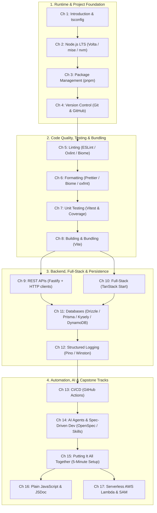

# TypeScript Development Environment Setup Guide

Welcome! If you've ever finished a university coding assignment where your entire project lived in a single 800-line file, used `console.log("HERE 1")` as your primary debugging strategy, and broke five minutes before submission because of a typo — this guide is for you.

Whether you're a CS student moving from classroom assignments to real-world engineering, or a junior developer leveling up your JavaScript/TypeScript workflow, this guide walks you through the professional toolkit: version control, linting, formatting, testing, building, AI agents, and deploying TypeScript projects.

## About This Guide

This is **not** a "what is a `for` loop?" tutorial. We assume you already know basic JavaScript or TypeScript (or are learning it alongside this guide). If you need a language refresher, bookmark these two:

- [TypeScript Handbook](https://www.typescriptlang.org/docs/) — the official TypeScript docs
- [MDN JavaScript Guide](https://developer.mozilla.org/en-US/docs/Web/JavaScript/Guide) — the gold-standard JavaScript reference

**What this guide IS:** a practical, no-fluff tour of the tools real engineering teams use so their code doesn't catch fire in production.

> **Currency note (2026):** Examples target **Node.js 22/24 LTS**, pnpm 10, and current tooling. Node 20 is end of life — let it rest in peace. Always re-check official docs for fast-moving tools (TanStack Start, Prisma, Oxc, Claude Code, Antigravity).

## Guide Roadmap

## Table of Contents

1. [Chapter 1: Introduction](./01-introduction.md) — TypeScript vs JavaScript, `tsconfig.json`, and the modern ecosystem
2. [Chapter 2: Node.js Environments](./02-node-environments.md) — LTS releases and managing Node versions with Volta, mise, and nvm
3. [Chapter 3: Package Management & package.json](./03-package-management.md) — `package.json`, pnpm vs npm, and why lock files save friendships
4. [Chapter 4: Version Control](./04-version-control.md) — Git essentials, `.gitignore`, and GitHub Flow
5. [Chapter 5: Linting](./05-linting.md) — Catching bugs automatically with ESLint, Oxlint, and Biome
6. [Chapter 6: Code Formatting](./06-code-formatting.md) — Ending tabs-vs-spaces arguments with Prettier, Biome, and oxfmt
7. [Chapter 7: Unit Testing with Vitest](./07-testing.md) — Writing fast unit tests and enforcing coverage thresholds
8. [Chapter 8: Building with Vite](./08-vite.md) — Instant dev servers, HMR, and production bundling
9. [Chapter 9: REST APIs with Fastify](./09-fastify.md) — Building fast, type-safe backend APIs with TypeBox validation, plus calling APIs with `fetch`, undici, and axios
10. [Chapter 10: Full-Stack with TanStack Start](./10-tanstack-start.md) — End-to-end type safety with file-based routing and server functions
11. [Chapter 11: Database Libraries](./11-databases.md) — Drizzle ORM, Prisma, Kysely, and DynamoDB
12. [Chapter 12: Structured Logging](./12-logging.md) — Graduating from `console.log` to Pino and Winston
13. [Chapter 13: CI/CD](./13-ci-cd.md) — Automating quality checks with GitHub Actions
14. [Chapter 14: LLMs and AI-Powered Development](./14-llms.md) — AI coding agents, Spec-Driven Development (OpenSpec, Spec Kit, EGM), and Addy Osmani's `agent-skills`
15. [Chapter 15: Putting It All Together](./15-putting-it-together.md) — Clean 5-minute TypeScript setup with Vite, Biome, Vitest, CI, and optional AI guardrails
16. [Chapter 16: Using This Setup for JavaScript Projects](./16-javascript.md) — JSDoc, `@ts-check`, and incremental migration
17. [Chapter 17: AWS Lambda with TypeScript](./17-aws-lambda.md) — Serverless functions with AWS SAM, Oxlint, DynamoDB, and Spec-Driven Development

## Prerequisites

- **Basic coding knowledge** — you've written code in JavaScript, TypeScript, Python, Java, or C++
- **A computer** — macOS, Linux, or Windows
- **A terminal** — you don't need to be a bash wizard, just willing to paste commands

Ready? Dive into [Chapter 1: Introduction](./01-introduction.md).

## License

Released under the [MIT License](./LICENSE).
